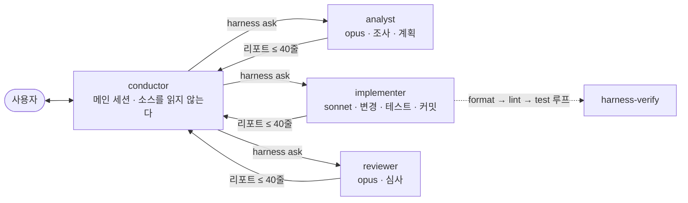

# claude-code-setup: conductor

**비싼 메인 세션은 지휘만 한다. 소스를 읽고 고치고 검토하는 일은 싼 headless 워커가 하고, 짧은 리포트만 돌려보낸다.**

A Claude Code setup where the main session only conducts. Headless worker sessions read, change and review the code, and send back reports of 40 lines or less.



## 왜 만들었나

- **토큰 비용.** 메인 세션은 가장 비싼 모델이다. 파일 하나를 읽을 때마다 그 내용이 세션 끝까지 컨텍스트에 남는다. 이 설정에서는 메인 세션이 소스를 아예 읽지 못한다. 훅 게이트가 막는다.
- **컨텍스트 보존.** 긴 세션에서 파일 덤프가 쌓이지 않는다. 리포트는 40줄 이하이고, 재시작 뒤에도 진행 요약 한 장이면 흐름이 이어진다.
- **리뷰 독립성.** analyst와 implementer는 프로젝트 메모리를 갖고 코드베이스를 매번 다시 파악하지 않는다. reviewer는 일부러 메모리가 없다. 매번 선입견 없이 시작하라고.

## 이렇게 보인다

세션 흐름을 줄인 예시다. 거부 메시지와 리포트 형식은 실제 그대로다.

```
> bin/harness의 exit code 설명을 README에 맞춰 고쳐줘

  Edit README.md
  ✗ Conductor cannot edit source. Delegate with the /implement skill (implementer worker).

> /implement README의 exit code 설명을 bin/harness의 실제 값에 맞춘다. 커밋은 하지 않는다.

  harness ask implementer 'Read .harness/task-implementer.md and do it.'   (백그라운드, 4분 48초)

  # implementer report — align README exit codes with bin/harness
  status: done
  ## Changed files
  - README.md — exit code 설명 (0-5)
  ## Verification
  - ./install.sh --test → 11 suites, FAIL 0
  ## Open questions
  - none
```

conductor는 리포트만 읽고 사용자에게 요약을 전한다. 사소하지 않은 변경은 `/review`가 뒤따르고, reviewer는 `VERDICT: PASS|FAIL`로 끝낸다.

## 빠른 시작

요구 사항: macOS, `/bin/bash` 3.2 · `jq` · Claude Code ≥ 2.1.248 · `PATH`에 `~/.local/bin`. [herdr](https://herdr.dev) ≥ 0.9는 선택이다. 워커 화면을 보여 주는 viewer일 뿐이다.

```bash
git clone https://github.com/geonhos/claude-code-setup ~/workspace/claude-code-setup
cd ~/workspace/claude-code-setup
./install.sh                 # 여러 번 실행해도 결과가 같다

cd ~/workspace/<your-repo>
harness init                 # 이 저장소를 harness 체크아웃으로 만든다
claude                       # 평소처럼 시작한다
```

`install.sh`는 에이전트·스킬 심링크, `bin/*` 링크, `~/.claude/settings.json`의 훅 병합을 한다. 백업을 남긴다. `harness init`은 `.harness/asks/`와 기본 설정, 그리고 `.claude/settings.local.json`의 `"agent": "conductor"`를 만든다.

되돌리기: `.harness/asks/`를 지우고, settings 파일의 `agent` 키를 지운다. 세션 하나만 끄려면 `HARNESS_ROLE=worker claude --agent solo`.

## 어떻게 도는가

1. 일반 질문은 conductor가 바로 답한다.
2. 소스를 읽거나 고치려 하면 게이트가 거부한다. 거부 사유에 쓸 스킬 이름이 있다. conductor가 `/analyze` 조사 · `/implement` 변경 · `/review` 검토를 호출한다. 직접 쳐도 된다.
3. 스킬이 `harness ask <worker>`를 백그라운드로 돌린다. 워커는 detached headless 세션(`claude -p`)이다. 실행 상한은 `headless_max_minutes`(기본 60, implementer 90)이고, 마감이 와도 run을 죽이지 않고 exit 4로 돌려준다.
4. implementer는 format → lint → test 루프를 통과해야 리포트를 낼 수 있다. 리포트 없이 멈추려 하면 Stop hook이 막는다.
5. 재시작이나 compaction 뒤에는 `harness wait <worker>`로 다시 붙는다. SessionStart 훅이 진행 요약 `.harness/progress.md`를 conductor에 넣는다.

| 역할 | 모델 | 메모리 | 하는 일 |
|---|---|---|---|
| conductor | 메인 세션 | 진행 요약만 | 질의 응답, 위임, 리포트 읽기, PR |
| analyst | opus | 프로젝트 메모리 | 조사, 설계, 계획. `docs/` 밖은 고치지 않는다 |
| implementer | sonnet | 프로젝트 메모리 | 변경, 테스트, 커밋, 푸시 |
| reviewer | opus | 없음 | diff 심사, `VERDICT: PASS\|FAIL` |

자주 쓰는 명령:

```
harness ask    <agent> '<instruction>'    # 워커에게 맡긴다 (스킬이 대신 호출한다)
harness wait   <agent>                    # run이 끝날 때까지 기다린다
harness report <agent>                    # 리포트를 다시 본다
harness status                            # 워커 상태
harness metrics                           # 최근 28일 ask 수, 실패율, 소요 시간
```

## 숫자로 보는 사용

이 저장소 자체가 이 루프로 개발된다. `harness metrics` 기준 최근 28일(2026-10-08 ~ 11-05):

| 지표 | 값 |
|---|---|
| ask | 250회 (analyst 42 · implementer 135 · reviewer 73) |
| 워커 소요 중앙값 | analyst 4분 · implementer 5분 · reviewer 3분 |
| reviewer FAIL 비율 | 36% (리뷰가 실제로 걸러낸다) |
| implementer 검증 실패율 | 0.7% |

## 테스트

`./install.sh --test`가 `tests/*.test.sh` 11개 스위트를 병렬로 돌린다. 가짜 `tests/fake-herdr`와 `tests/fake-claude`를 쓰므로 herdr도 Claude도 필요 없다.

## 더 읽기

- [docs/reference.md](docs/reference.md): 설치 상세, `harness init` 옵션, CLI 전체와 exit code, 설정 키, 검증 루프, conductor 게이트 허용 목록, 디렉터리 구성
- [docs/architecture.md](docs/architecture.md): 런타임 데이터 흐름, ask 시퀀스, 게이트 판정 흐름
- [docs/wiki/index.md](docs/wiki/index.md): 함정, 절차, 결정 기록

MIT License.
