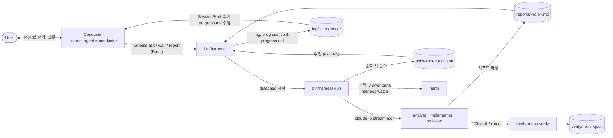
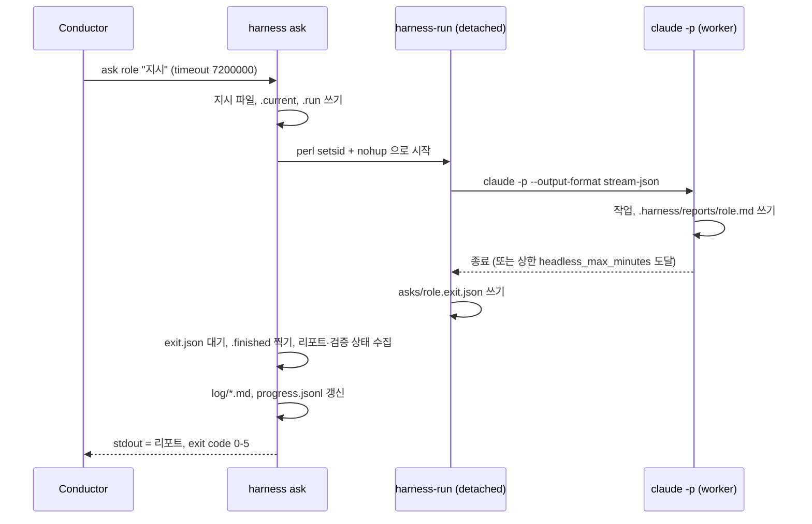
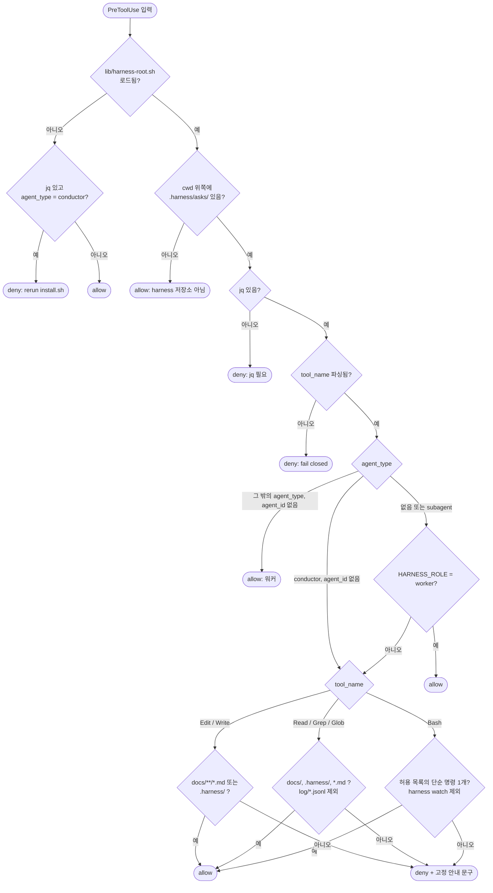
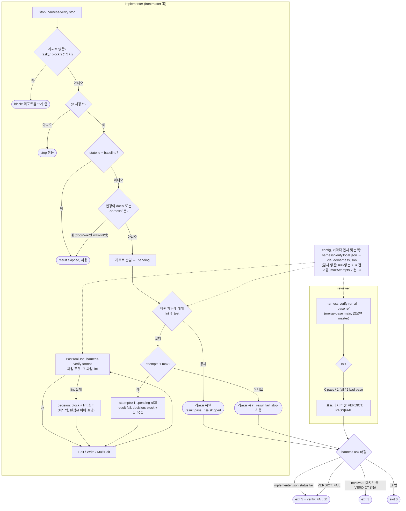

# 아키텍처

이 harness는 **conductor(지휘 세션)** Claude 세션 하나와 워커 Claude 세션 셋(analyst, implementer, reviewer)으로 이뤄진다. 워커는 detached headless 세션(`claude -p`)으로 돌고(결정 0011), [herdr](https://herdr.dev) pane은 선택 사항인 viewer다. conductor에는 PreToolUse 훅 게이트가 걸려 있어 리포트 읽기와 `harness` 실행만 할 수 있다. 저장소 루트의 `.harness/`는 리포트, 로그, 검증 상태, 진행 요약을 두는 공용 저장소다. 설치 방법과 사용법은 [README](../README.md), 함정과 결정은 [`wiki/index.md`](wiki/index.md).

## 1. 런타임 데이터 흐름

설정은 `install.sh`가 `~/.claude/settings.json`에 훅을 쓰고, `agents/`, `skills/`, `bin/`을 `~/.claude`와 `~/.local/bin`에 심볼릭 링크하는 것이 전부다. 저장소마다 `harness init`이 `.harness/asks/`와 `agent = conductor`를 만든다. 훅은 `lib/harness-root.sh`의 `harness_root`로 체크아웃 루트를 찾고, 없으면 아무것도 하지 않는다.

## 2. harness ask 시퀀스

마감 시간이 지나도 run을 죽이지 않는다(`--timeout`은 대기 시간이다). 대기가 끝났는데 run이 살아 있으면 exit 4이고, 나중에 `harness report <role>`로 수집한다. conductor가 재시작되면 `harness wait <role>`이 이어서 기다린다. 직전 ask가 0이 아니었으면 다음 ask는 같은 세션을 `--resume`한다(`--fresh`로 끔). 원본 스트림 `.harness/log/*.jsonl`은 게이트가 conductor의 읽기를 막는다.

## 3. conductor 게이트 판정 흐름 (conductor-gate.sh)

경로는 심볼릭 링크를 푼 뒤에도 같은 규칙을 통과해야 한다. Bash는 `scan_command`가 `; & | < > #` 백틱, `$(`를 거부하고, 남은 단일 명령을 허용 목록(`harness`, `gh pr ...`, 읽기 전용 `git`, `herdr pane get|current`, `.harness/`·`docs/` 아래 `cat`/`ls`)에 맞춰 본다. 결정은 0005, 0010, 0012.

## 4. 검증 루프

`harness ask implementer`는 먼저 `harness-verify baseline`을 호출한다(state id = HEAD + 작업 트리 변경분의 해시, 실패한 뒤에도 base는 유지). Stop 훅은 검사하는 동안 리포트를 숨기므로 `harness`가 검증 전 리포트를 볼 일은 없다. 시도 횟수 상한에 닿으면 리포트를 그대로 두고 `harness`가 exit 5로 끝난다. Stop 훅 검증 중에 마감되면 exit 4 "still verifying"이다(결정 0009).

## 5. 진행 로그

`harness ask`는 exit code와 관계없이 매번 `.harness/log/<ts>-<agent>.md`(instruction, brief 파일 내용, 리포트)를 쓰고, `.harness/progress.jsonl`에 JSON 한 줄(ts, agent, session, instr, exit, verify, dur_s, head_before/after, status, summary)을 덧붙인 뒤 `.harness/progress.md`를 다시 만든다. `progress.md`는 60줄 이하이고 goal, 최근 ask 15개, 미해결 질문, 워커 상태가 들어간다. goal 줄은 한 문단짜리 `.harness/goal.md`로 정한다. 로그 작업이 실패해도 stderr에 경고만 찍고 ask 결과는 바꾸지 않는다.

`SessionStart` 훅(`claude/hooks/conductor-resume.sh`, matcher `startup|clear|compact`)이 `progress.md`를 conductor 컨텍스트에 넣는다. 워커 세션에서는 아무것도 출력하지 않는다. ask가 끝날 때마다 로그를 정리한다: 최신 200개만 남기고(`HARNESS_LOG_KEEP`), 14일이 지난 것은 지우고(`HARNESS_LOG_DAYS`), 1 MB를 넘은 `progress.jsonl`은 `progress.jsonl.<ts>.gz`로 압축해 옮긴다(`HARNESS_JSONL_MAX`, 바이트). `harness status`의 `ctx` 열은 끝난 run의 `exit.json`에서 읽은 토큰 수이고 알 수 없으면 `-`다.

## Exit code

`harness ask`의 exit code (`bin/harness` 머리 주석과 같다). `harness report`는 같은 코드를 쓰고 run이 아직 돌면 4를 더한다.

| code | 의미 |
|---|---|
| 0 | 리포트를 stdout에 출력 |
| 1 | 사용법 또는 설정 오류 |
| 2 | run이 도구 호출을 거부당했고 리포트가 없음 (brief를 바꿔 다시 ask) |
| 3 | 워커가 리포트 없이 끝남 (reviewer는 마지막 `VERDICT:` 줄이 없어도 3) |
| 4 | run이 아직 돌고 있거나 알 수 없음 (`harness report <role>`로 수집) |
| 5 | 검증 실패 (implementer 검사 포기 또는 reviewer `VERDICT: FAIL`); 리포트는 그대로 stdout에 나온다 |
