# 아키텍처

이 harness는 **conductor(지휘 세션)** Claude 세션 하나와 워커 Claude 세션 셋(analyst, implementer, reviewer)으로 이뤄진다. 워커는 [herdr](https://herdr.dev) 패널에서 돈다. conductor에는 PreToolUse 훅 게이트가 걸려 있어 리포트 읽기와 `harness` 실행만 할 수 있다. 프로젝트 디렉터리의 `.harness/`는 리포트, 로그, 검증 상태, 진행 요약을 두는 공용 저장소다.

아래 다이어그램은 스펙이 아니라 `main`의 코드(커밋 `bdcf357`, PR #10을 main에 머지한 시점)를 기준으로 그렸다. Mermaid 원본은 [`diagrams/`](diagrams/README.md)에 있다. 8절과 2·7절의 Mermaid 텍스트는 feature/v8-skill-routing 변경을 반영했고 SVG는 아직 재렌더하지 않았다.

## 목차

1. [런타임 데이터 흐름](#1-런타임-데이터-흐름)
2. [설정과 훅 연결](#2-설정과-훅-연결)
3. [harness ask 시퀀스](#3-harness-ask-시퀀스)
4. [conductor 게이트 판정 흐름 (conductor-gate.sh)](#4-conductor-게이트-판정-흐름-conductor-gatesh)
5. [검증 루프](#5-검증-루프)
6. [진행 로그와 컨텍스트 리셋](#6-진행-로그와-컨텍스트-리셋)
7. [설치 구성 (install.sh)](#7-설치-구성-installsh)
8. [라우팅 로그와 스킬](#8-라우팅-로그와-스킬)
9. [Exit code](#exit-code)

## 1. 런타임 데이터 흐름


<details><summary>Mermaid 원본</summary>

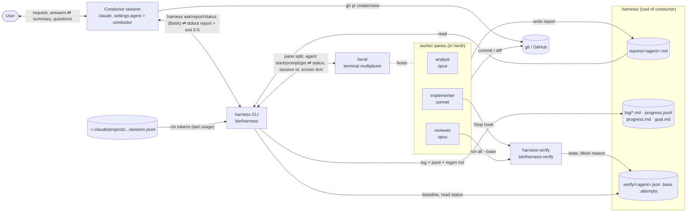

</details>

conductor는 소스를 건드리지 않는다. 사용자와 대화하고, `harness`(게이트가 검사하는 Bash)를 실행하고, 리포트만 읽는다. 워커가 `.harness/`에 리포트를 쓰면 `harness`가 그것을 읽고, ask마다 로그를 남기고, exit code를 돌려준다. 컨텍스트 크기는 `~/.claude/projects` 아래 워커 트랜스크립트에서 가져온다.

## 2. 설정과 훅 연결


<details><summary>Mermaid 원본</summary>

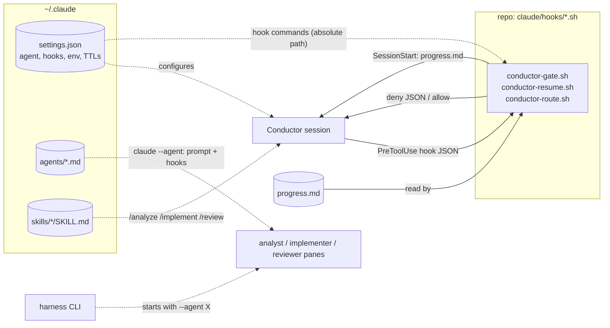

</details>

`~/.claude/settings.json`이 평범한 `claude` 세션을 모두 conductor로 만들고, PreToolUse 게이트와 SessionStart resume 훅을 등록한다. 워커의 프롬프트와 훅은 `claude --agent`가 `agents/*.md`에서 가져온다. UserPromptSubmit 훅(`conductor-route.sh`)은 프롬프트마다 `.harness/routing.jsonl`에 한 줄을 남긴다.

## 3. `harness ask` 시퀀스


<details><summary>Mermaid 원본</summary>


</details>

컨텍스트 리셋은 "still working" 확인 뒤, 이전 리포트를 지우고 프롬프트를 보내기 전에 실행된다. 방금 띄운 워커는 리셋하지 않는다. 결과가 무엇이든(wrapper가 SIGTERM/INT/HUP을 받아 exit 143/130/129로 끝나는 경우 포함) `ask_finish`가 버퍼에 담아 둔 stdout을 다시 출력하고 로그를 쓴다.

## 4. conductor 게이트 판정 흐름 (`conductor-gate.sh`)


<details><summary>Mermaid 원본</summary>

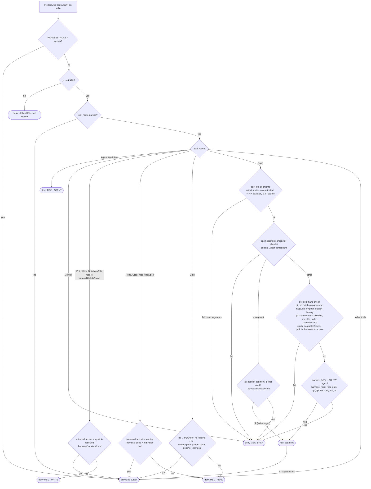

</details>

기본 역할은 conductor이고, `HARNESS_ROLE=worker`일 때만 게이트가 꺼진다. jq가 없으면 fail closed지만, 입력을 파싱하지 못하면 fail open이다. 거부 사유는 모두 써야 할 스킬 이름(과 워커)을 담은 고정 문자열이다(프롬프트 캐시를 안정적으로 유지하려는 것). Bash 명령은 `; & |`로 나눈 세그먼트가 전부 통과해야 허용된다. `jq` 세그먼트는 `jq_segment_ok`만으로 검사하고 `BASH_ALLOW` 정규식은 거치지 않는다.

## 5. 검증 루프


<details><summary>Mermaid 원본</summary>

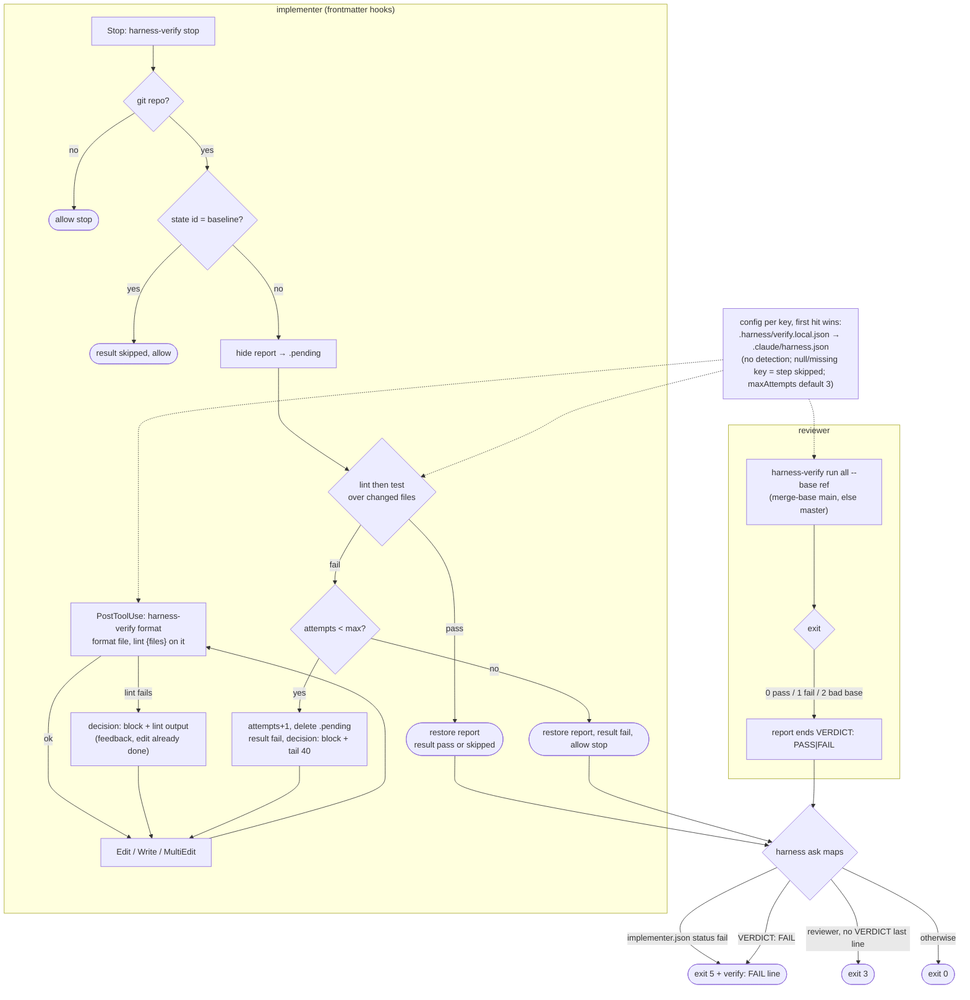

</details>

`harness ask implementer`는 먼저 `harness-verify baseline`을 호출한다(state id = HEAD + 작업 트리 변경분의 해시, 실패한 뒤에도 base는 유지). Stop 훅은 검사하는 동안 리포트를 숨기므로 `harness`가 검증 전 리포트를 볼 일은 없다. 시도 횟수 상한에 닿으면 리포트를 그대로 두고 `harness`가 exit 5로 끝난다.

## 6. 진행 로그와 컨텍스트 리셋


<details><summary>Mermaid 원본</summary>

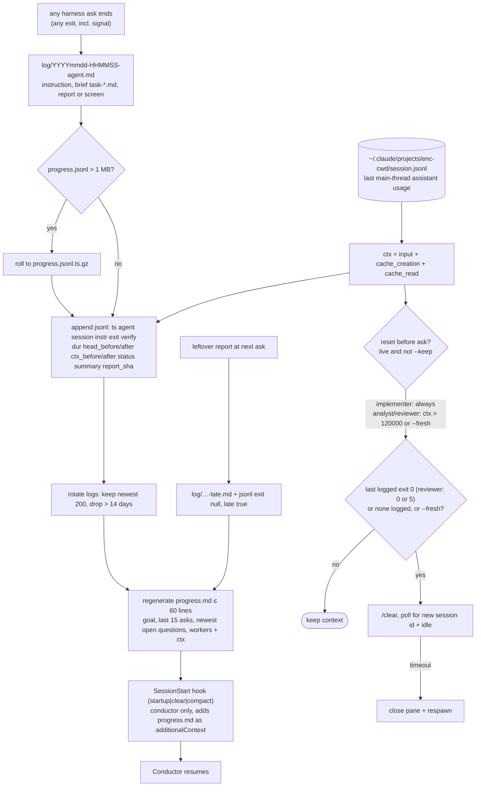

</details>

ask마다 로그 파일과 jsonl 한 줄을 쓰고 `progress.md`를 다시 만든다. 로그 작업이 실패해도 경고만 출력한다. conductor의 SessionStart 훅이 재시작, `/clear`, 컴팩션 뒤에 `progress.md`를 다시 넣어 준다. 조절 변수: `HARNESS_LOG_KEEP`, `HARNESS_LOG_DAYS`, `HARNESS_JSONL_MAX`, `HARNESS_CTX_RESET`.

## 7. 설치 구성 (`install.sh`)


<details><summary>Mermaid 원본</summary>

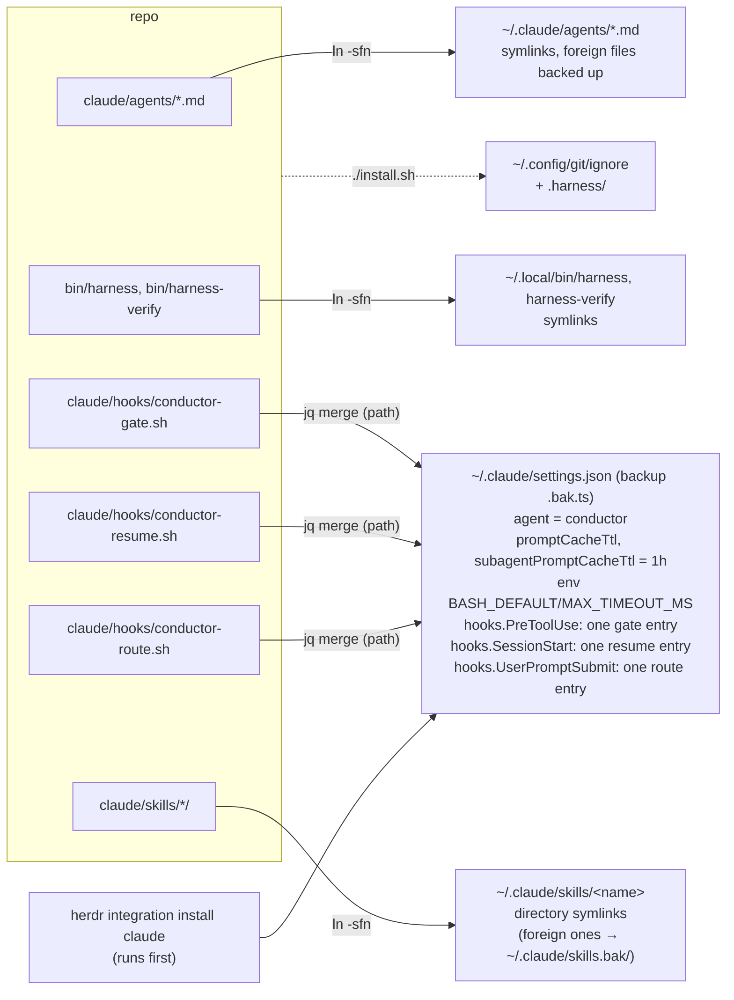

</details>

여러 번 실행해도 결과가 같다. 다시 실행하면 게이트/resume/route 항목이 중복 추가되지 않고 교체된다. 훅은 복사하지 않고 저장소의 절대 경로로 참조한다. 게이트 matcher는 `Edit|Write|NotebookEdit|Read|Grep|Glob|Bash|Agent|Workflow|Monitor|mcp__filesystem__.*`다.

SVG는 아직 재렌더하지 않았다(렌더 방법은 [diagrams/README.md](diagrams/README.md)).

## 8. 라우팅 로그와 스킬

conductor는 기본적으로 직접 답하고, 소스 읽기·변경·검증이 필요할 때만 스킬로 워커에 위임한다. 스킬은 `claude/skills/<name>/SKILL.md`에 있고 `install.sh`가 `~/.claude/skills/<name>`에 디렉터리 심링크한다.

| 스킬 | 워커 | 브리프 파일 | 실행 명령 |
|---|---|---|---|
| `/analyze` | analyst (opus) | `.harness/task-analyst.md` | `harness ask analyst '…' --via skill` |
| `/implement` | implementer (sonnet) | `.harness/task-implementer.md` | `harness ask implementer '…' --via skill` |
| `/review` | reviewer (opus) | `.harness/task-reviewer.md` | `harness ask reviewer '…' --via skill` |

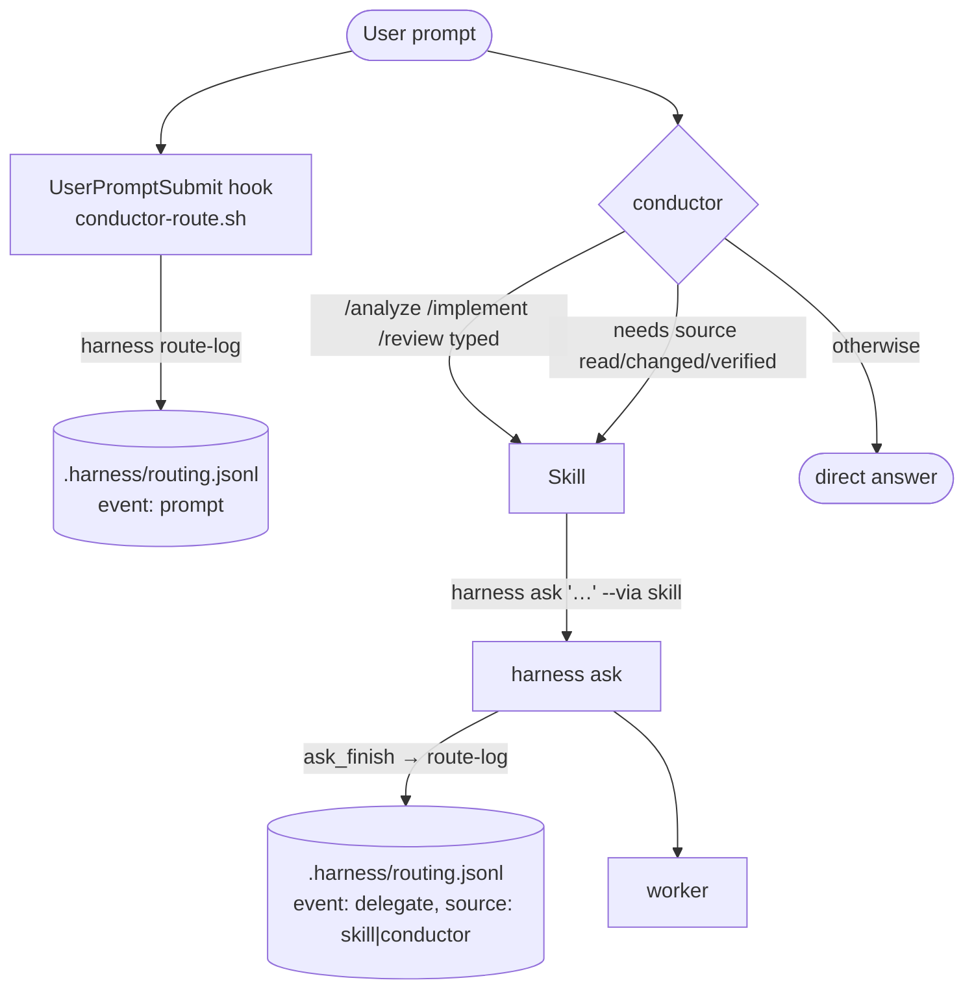

`routing.jsonl`은 append-only이고 줄이 두 종류다.

```json
{"ts":"2026-10-20T05:12:01Z","event":"prompt","session":"<id>","prompt_id":"<id>","agent":"conductor","prompt":"...","skill":"/implement"}
{"ts":"2026-10-20T05:12:40Z","event":"delegate","session":"<id>","worker":"implementer","source":"skill","exit":0}
```

- `prompt` 줄은 훅이 쓴다. `prompt_id`는 훅 payload의 `prompt_id`, `agent`는 `agent_type`(없으면 null)이라 conductor가 아닌 세션의 프롬프트를 오프라인에서 걸러낼 수 있고, `prompt`는 4000자에서 잘린다. `skill`은 입력의 첫 토큰이 `/analyze`, `/implement`, `/review` 중 하나일 때만 채워진다(`/analyzefoo`는 아님).
- `delegate` 줄은 `harness ask`가 끝날 때(시그널 포함) 쓴다. `source`는 `--via` 값(기본 `conductor`), `session`은 conductor Bash 환경의 `CLAUDE_CODE_SESSION_ID`.
- 직접 답변은 기록하지 않는다. 같은 `session`에서 다음 `prompt` 줄 전까지 `delegate` 줄이 없으면 직접 답변으로 본다.
- 로테이션은 `progress.jsonl`과 같다(`HARNESS_JSONL_MAX`, 기본 1 MiB, gzip). `HARNESS_ROUTE_LOG=0`으로 끈다.
- 워커 세션에서는 `harness ask`/`spawn`이 exit 1로 거부된다(HARNESS_ROLE=worker).
- 훅은 `HARNESS_ROLE=worker`, jq/harness 부재, cwd에 `.harness/` 없음, 입력 오류 어느 경우에도 무출력 exit 0이다. 프롬프트를 막거나 컨텍스트를 주입하지 않는다.

이 로그는 나중에 결정 모델(Kev)을 파인튜닝해 "직접 답변 / 어느 워커" 힌트를 주입하기 위한 학습 데이터다. 배경과 모델 선택 근거는 [`research/2026-10-20-decision-models-kev-vs-laya.md`](research/2026-10-20-decision-models-kev-vs-laya.md), 설계는 [`superpowers/specs/2026-10-20-skill-routing-design.md`](superpowers/specs/2026-10-20-skill-routing-design.md).

## Exit code

| 코드 | 의미 |
|------|------|
| 0 | 리포트를 돌려줌, 검증 통과(또는 해당 없음) |
| 1 | 설정 오류 (예: implementer에게 ask했는데 `harness-verify`가 `PATH`에 없음) |
| 2 | 워커가 막혀서 입력을 기다림. 화면을 돌려줌 |
| 3 | 리포트가 없음 (또는 reviewer 리포트에 마지막 `VERDICT:` 줄이 없음) |
| 4 | 워커가 아직 작업 중이거나 준비되지 않았음, 또는 프롬프트 전송 실패. 쓸 만한 결과 없음 |
| 5 | 리포트는 있으나 검증이 실패했거나 중단됨 (`VERDICT: FAIL`, `verify: FAIL`/`INTERRUPTED`) |
| 129 / 130 / 143 | wrapper가 SIGHUP / SIGINT / SIGTERM을 받음. 로그는 그래도 기록됨 |
