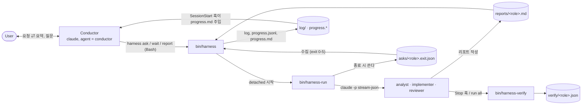

# 아키텍처

이 harness는 **conductor(지휘 세션)** Claude 세션 하나와 워커 Claude 세션 셋(analyst, implementer, reviewer)으로 이뤄진다. 워커는 detached headless 세션(`claude -p`)으로 돈다(결정 0011). 진행은 사용자가 아무 터미널에서 `harness watch <role>`로 본다(결정 0013). conductor에는 PreToolUse 훅 게이트가 걸려 있어 리포트 읽기와 `harness` 실행만 할 수 있다. 저장소 루트의 `.harness/`는 리포트, 로그, 검증 상태, 진행 요약을 두는 공용 저장소다. 설치 방법과 사용법은 [README](../README.md), 함정과 결정은 [`wiki/index.md`](wiki/index.md).

## 1. 런타임 데이터 흐름

설정은 `install.sh`가 `~/.claude/settings.json`에 훅을 쓰고, `agents/`, `skills/`, `bin/`을 `~/.claude`와 `~/.local/bin`에 심볼릭 링크하는 것이 전부다. 저장소마다 `harness init`이 `.harness/asks/`와 `agent = conductor`를 만든다. 훅은 `lib/harness-root.sh`의 `harness_root`로 체크아웃 루트를 찾고, 없으면 아무것도 하지 않는다.

## 2. harness ask 수명

`harness ask`는 지시 파일과 `.current`, `.run`을 쓰고 `harness-run`을 `perl setsid + nohup`으로 띄운 뒤 `asks/<role>.exit.json`을 기다려 리포트와 검증 상태를 수집한다(그림 1의 흐름).

마감 시간이 지나도 run을 죽이지 않는다(`--timeout`은 대기 시간이다). 대기가 끝났는데 run이 살아 있으면 exit 4이고, 나중에 `harness report <role>`로 수집한다. conductor가 재시작되면 `harness wait <role>`이 이어서 기다린다. 원본 스트림 `.harness/log/*.jsonl`은 게이트가 conductor의 읽기를 막는다.

## 3. conductor 게이트 판정 흐름 (conductor-gate.sh)

conductor 세션의 PreToolUse 호출만 판정한다: `.harness/asks/`가 없는 저장소, 워커(`agent_type`이 conductor가 아님, 또는 `HARNESS_ROLE=worker`)는 통과시키고, jq가 없거나 입력을 파싱하지 못하면 거부한다(fail closed). 나머지는 도구별 허용 범위(쓰기는 `docs/**/*.md`와 `.harness/`, 읽기는 `docs/`, `.harness/`, `*.md`에서 `log/*.jsonl` 제외, Bash는 허용 목록의 단순 명령 1개)에 맞지 않으면 고정 안내 문구와 함께 거부한다. 경로는 심볼릭 링크를 푼 뒤에도 같은 규칙을 통과해야 한다. Bash는 `scan_command`가 `; & | < > #` 백틱, `$(`를 거부하고, 남은 단일 명령을 허용 목록(`harness`, `gh pr ...`, 읽기 전용 `git`, `.harness/`·`docs/` 아래 `cat`/`ls`)에 맞춰 본다. 결정은 0005, 0010, 0012.

## 4. 검증 루프

implementer의 frontmatter 훅이 `harness-verify`를 루프 안에서 돌린다. 설정은 키마다 먼저 맞는 쪽(`.harness/verify.local.json` → `.claude/harness.json`)이고, 감지는 없으며 null이거나 없는 키는 건너뛴다(`maxAttempts` 기본 3).

- `PostToolUse`(Edit/Write/MultiEdit): 파일 포맷과 그 파일 lint. 실패하면 출력과 함께 block한다(편집은 이미 끝난 뒤의 피드백).
- `Stop`: 리포트가 없으면 먼저 막아 쓰게 한다(ask당 2번까지). git 저장소가 아니거나 state id가 baseline과 같으면 건너뛴다. 변경이 `docs/`나 `.harness/`뿐이면 건너뛰고, `docs/wiki`면 `wiki-lint`만 돈다. 그 밖에는 리포트를 `.pending`으로 숨기고 바뀐 파일에 lint, test를 돌린다. 통과하면 리포트를 복원하고, 실패하면 시도 횟수를 올려 끝 40줄과 함께 block한다. 상한에 닿으면 리포트를 복원하고 `result: fail`로 stop을 허용한다.
- reviewer는 `harness-verify run all --base <ref>`(merge-base main, 없으면 master)를 돌리고 리포트 마지막 줄에 `VERDICT: PASS|FAIL`을 적는다.
- `harness ask` 매핑: `verify/implementer.json`이 fail이거나 `VERDICT: FAIL`이면 exit 5, reviewer 리포트에 VERDICT 줄이 없으면 exit 3, 그 밖은 0.

`harness ask implementer`는 먼저 `harness-verify baseline`을 호출한다(state id = HEAD + 작업 트리 변경분의 해시, 실패한 뒤에도 base는 유지). Stop 훅은 검사하는 동안 리포트를 숨기므로 `harness`가 검증 전 리포트를 볼 일은 없다. 시도 횟수 상한에 닿으면 리포트를 그대로 두고 `harness ask`가 exit 5로 끝난다. Stop 훅 검증 중에 마감되면 exit 4 "still verifying"이다(결정 0009).

## 5. 진행 로그

`harness ask`는 exit code와 관계없이 `.harness/log/<ts>-<agent>.md`와 `progress.jsonl` 한 줄을 쓰고 `progress.md`(60줄 이하: goal, 최근 ask, 미해결 질문, 워커 상태)를 다시 만든다. 로그 작업이 실패해도 stderr 경고만 찍고 ask 결과는 바꾸지 않는다.

`SessionStart` 훅(`claude/hooks/conductor-resume.sh`, matcher `startup|clear|compact`)이 `progress.md`를 conductor 컨텍스트에 넣는다. 워커 세션에서는 아무것도 출력하지 않는다. 로그 정리 기준은 [reference.md](reference.md)의 설정에 있다.

