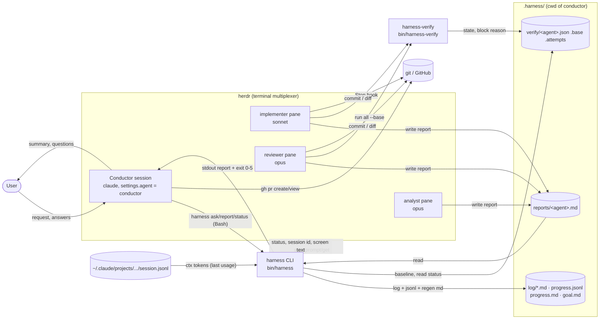
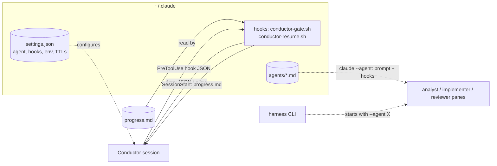
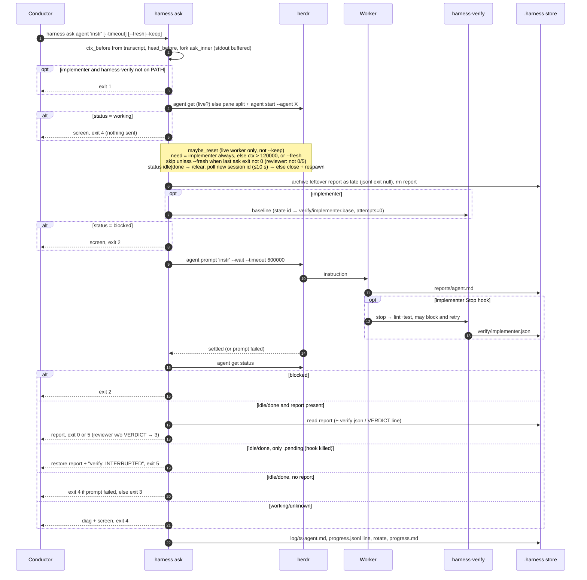
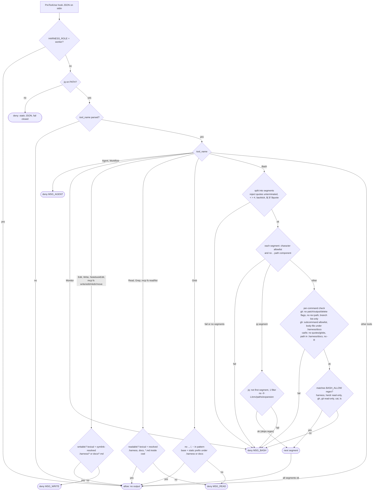
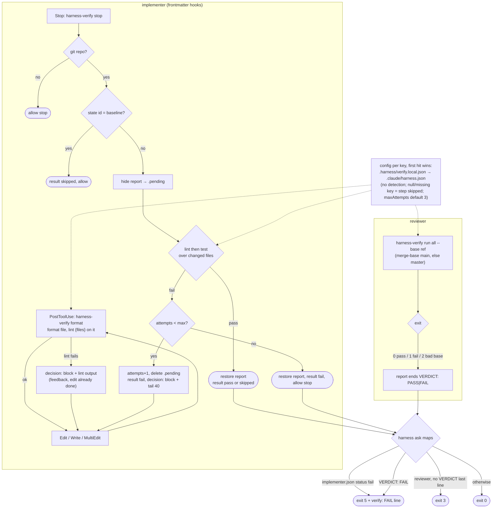
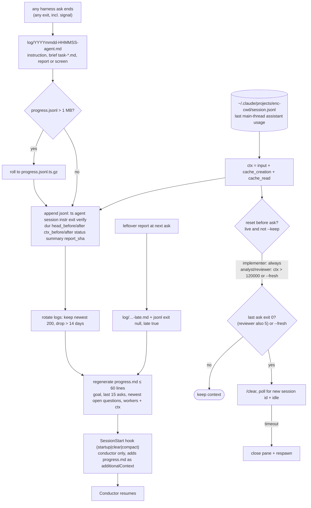
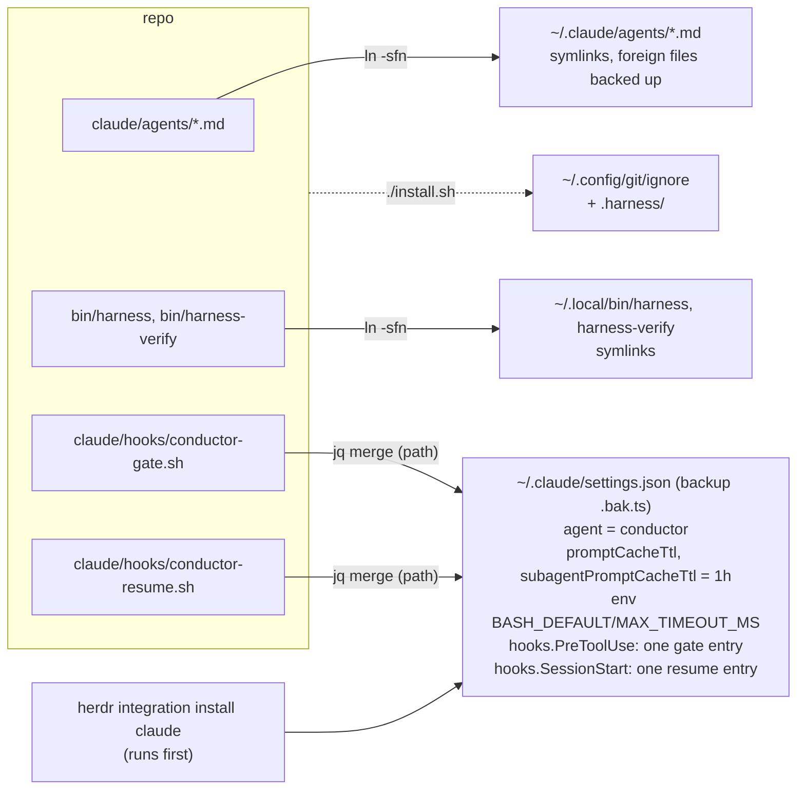

# Architecture

The harness is a **conductor** Claude session, gated by a PreToolUse hook so it can only read reports and run `harness`, plus three worker Claude sessions (analyst, implementer, reviewer) in [herdr](https://herdr.dev) panes. `.harness/` in the project directory is the shared store for reports, logs, verification state and the progress summary.

These diagrams describe the code on `main` as of commit `583e0e5`, not the specs. Mermaid sources live in [`diagrams/`](diagrams/README.md).

## Contents

1. [Runtime data flow](#1-runtime-data-flow)
2. [Config and hook wiring](#2-config-and-hook-wiring)
3. [harness ask sequence](#3-harness-ask-sequence)
4. [Conductor gate decision flow (conductor-gate.sh)](#4-conductor-gate-decision-flow-conductor-gatesh)
5. [Verification loop](#5-verification-loop)
6. [Progress log and context reset](#6-progress-log-and-context-reset)
7. [Install layout (install.sh)](#7-install-layout-installsh)
8. [Exit codes](#exit-codes)

## 1. Runtime data flow

Mermaid source

The conductor never touches source: it talks to the user, runs `harness` (gated Bash), and reads only reports. Workers write reports into `.harness/`; `harness` reads them, logs every ask and returns an exit code. Context size comes from the worker's transcript under `~/.claude/projects`.

## 2. Config and hook wiring

Mermaid source

`~/.claude/settings.json` makes every plain `claude` session the conductor and registers the PreToolUse gate and the SessionStart resume hook. Worker prompts and their hooks come from `agents/*.md` via `claude --agent`.

## 3. `harness ask` sequence

Mermaid source

The context reset runs after the "still working" check and before the old report is removed and the prompt is sent; a freshly spawned worker is never reset. Whatever the outcome (including SIGTERM/INT/HUP of the wrapper → exit 143/130/129), `ask_finish` replays the buffered stdout and writes the log.

## 4. Conductor gate decision flow (`conductor-gate.sh`)

Mermaid source

Default role is conductor; only `HARNESS_ROLE=worker` turns the gate off. Missing jq fails closed, but unparseable input fails open. Every deny reason is a fixed string naming the worker to use (stable prompt cache). A Bash command is allowed only when every `; & |`-separated segment passes; `jq` segments are checked by `jq_segment_ok` alone and never hit the `BASH_ALLOW` regex.

## 5. Verification loop

Mermaid source

`harness ask implementer` first calls `harness-verify baseline` (state id = HEAD + hash of working-tree changes; the base is kept after a fail). The Stop hook hides the report while checking, so `harness` never sees an unverified one; at the attempt cap it keeps the report and `harness` exits 5.

## 6. Progress log and context reset

Mermaid source

Every ask writes a log file and a jsonl line and rebuilds `progress.md`; logging failures only warn. The conductor's SessionStart hook feeds `progress.md` back after a restart, `/clear` or compaction. Knobs: `HARNESS_LOG_KEEP`, `HARNESS_LOG_DAYS`, `HARNESS_JSONL_MAX`, `HARNESS_CTX_RESET`.

## 7. Install layout (`install.sh`)

Mermaid source

Idempotent: re-running replaces the gate/resume entries instead of adding duplicates. Hooks are referenced by absolute repo path, not copied. The gate matcher is `Edit|Write|NotebookEdit|Read|Grep|Glob|Bash|Agent|Workflow|Monitor|mcp__filesystem__.*`.

## Exit codes

| Code | Meaning |
|------|---------|
| 0 | Report returned, verification passed (or not applicable) |
| 1 | Setup error (e.g. implementer asked but `harness-verify` not on PATH) |
| 2 | Worker blocked, waiting for input; screen returned |
| 3 | No report produced (or reviewer report without a final `VERDICT:` line) |
| 4 | Worker still working / not ready, or prompt failed; nothing usable returned |
| 5 | Report returned but verification failed or was interrupted (`VERDICT: FAIL`, `verify: FAIL`/`INTERRUPTED`) |
| 129 / 130 / 143 | Wrapper received SIGHUP / SIGINT / SIGTERM; log still written |
