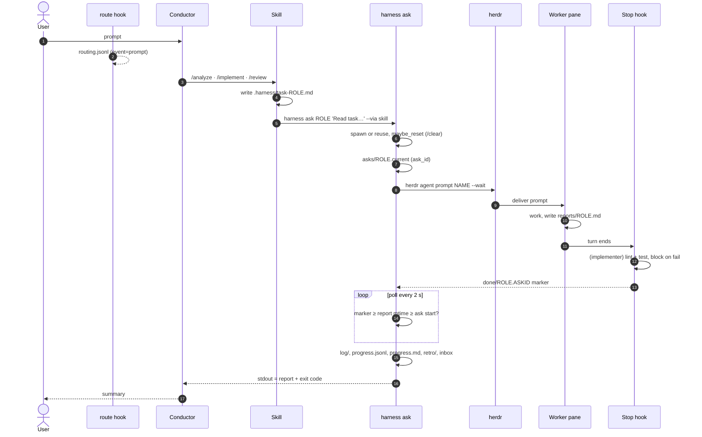

# 01 Dispatch flow

## Files written along the way

| File | Writer | Reader |
|---|---|---|
| `.harness/routing.jsonl` | route hook (prompt), ask_finish (delegate) | `harness metrics` |
| `.harness/task-<role>.md` | skill (conductor) | worker, log copy |
| `.harness/asks/<role>.current` | ask_inner H:958 | completion check |
| `.harness/reports/<role>.md` | worker | harness → conductor |
| `reports/implementer.md.pending` | `harness-verify stop` (hidden while verifying) | restore / INTERRUPTED |
| `.harness/done/<role>.<ask-id>` | Stop hook V:239 | ask_complete H:1062 |
| `.harness/log/<stamp>-<role>.md` | record_progress H:378 | humans, retro |
| `.harness/progress.jsonl`, `progress.md` | record_progress, write_progress_md H:609 | metrics, maybe_reset, SessionStart |
| `.harness/retro/<ask-id>.json` | retro_on_ask H:485 (abnormal exit) | `harness retro` |
| `docs/wiki/inbox/*.md` | queue_learned H:681 (`## Learned`) | human review |
