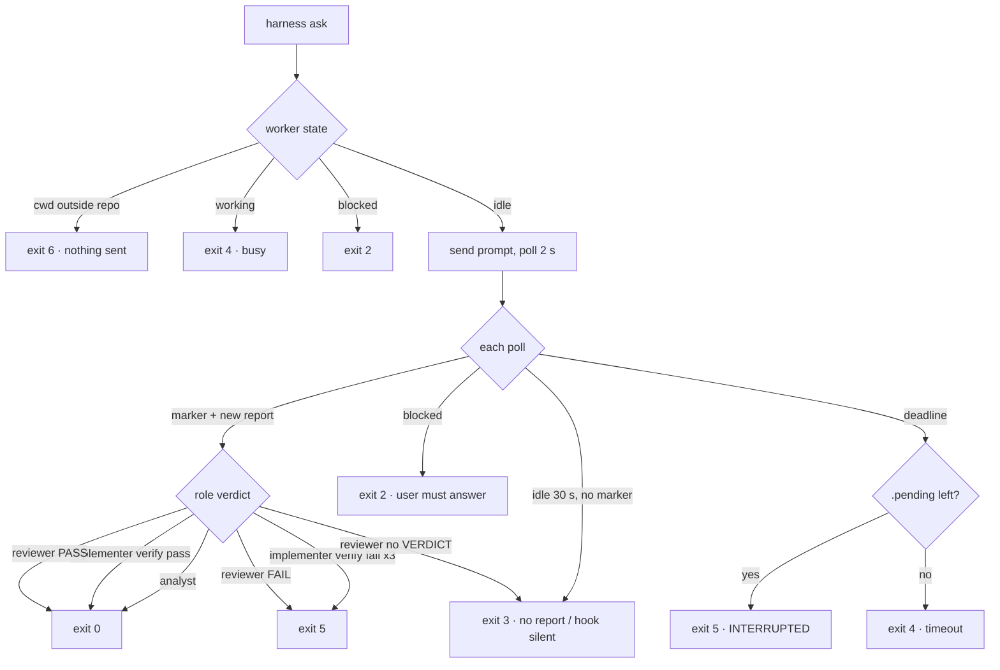

# 02 Worker execution

## Spawn (cmd_spawn H:222)
1. Name `<role>-<repo8>`, repo8 = sha1(git toplevel)[0:8] (H:99–114).
2. Live already → cwd check; outside the repo → exit 6 (H:134).
3. `herdr pane split` with env `HARNESS_ROLE=worker`, `CLAUDE_CODE_AUTO_COMPACT_WINDOW=160000`.
4. `herdr agent start <name> --kind claude -- --agent <role>`.

| Role | Model | Stop hook | Other |
|---|---|---|---|
| analyst | opus | `harness-verify done analyst` | — |
| implementer | sonnet | `harness-verify stop` (600 s) | PostToolUse → `harness-verify format` |
| reviewer | opus | `harness-verify done reviewer` | last line must be `VERDICT:` |

## Context reset (maybe_reset H:331)
- implementer: always `/clear`.
- analyst / reviewer: when ctx > 120k or `--fresh`.
- Skipped after a failed last exit (kept for follow-ups) unless `--fresh`.
- `/clear` fails → close pane and respawn.

## Completion and exit codes

## Timeouts

| Layer | Value |
|---|---|
| `harness ask` default (all roles) | 600000 ms (H:63) |
| /analyze, /review Bash timeout | 660000 ms |
| /implement | `--timeout 1740000`, Bash 1800000 |
| implementer Stop hook | 600 s |
| idle grace / poll | 30 s / 2 s |

## Pane lifecycle
- `close_after_ask`: implementer closes on exit 0 and respawns next ask; others never (H:1144).
- idle TTL: idle ≥ 30 min with report collected → reaped on next ask/spawn/status (H:1332).
- `HARNESS_NO_AUTOCLOSE=1` turns both off; `harness close` refuses (exit 4) on working/uncollected.
