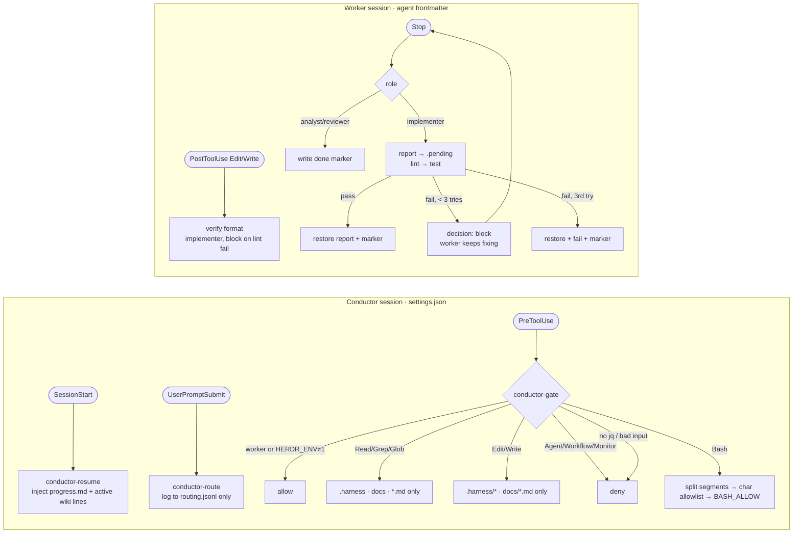

# 03 Hooks

Conductor hooks are registered by `install.sh` in `~/.claude/settings.json`; worker hooks
live in each agent file's frontmatter, so a hook change needs a worker respawn.

| Hook | On failure |
|---|---|
| conductor-gate | fail closed: no jq or unparseable input → deny (decision 0005) |
| conductor-route, conductor-resume | never fail, stay silent |
| verify done | no marker → harness waits 30 s grace, exit 3 |
| verify stop | hook killed → stale `.pending` → ask waits full timeout, exit 5 INTERRUPTED |
| verify format | no jq → exit 0 (silent pass) |
