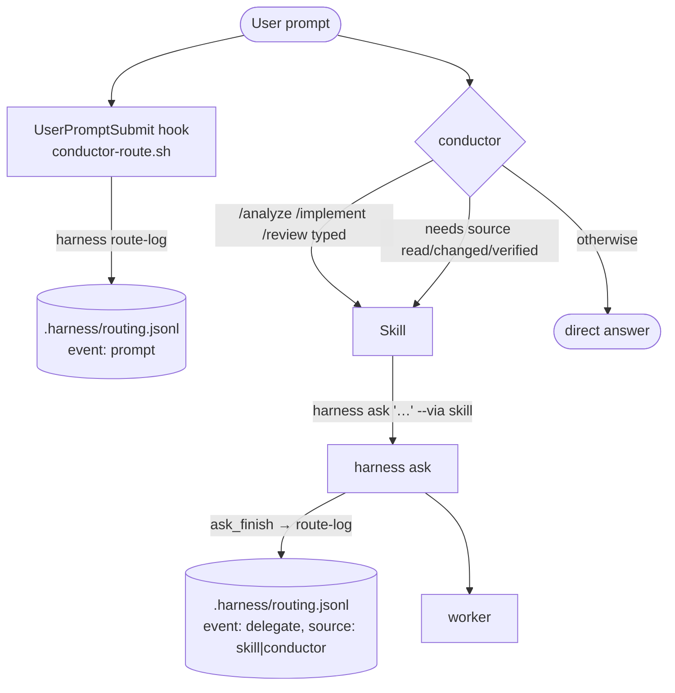

# 스킬 기반 위임 + conductor 직접 답변 + 라우팅 로그 — 구현 계획

> **For agentic workers:** REQUIRED SUB-SKILL: Use superpowers:subagent-driven-development (recommended) or superpowers:executing-plans to implement this plan task-by-task. Steps use checkbox (`- [ ]`) syntax for tracking.

**Goal:** conductor가 평범한 질의는 직접 답하고, 워커 위임은 `/analyze` `/implement` `/review` 스킬로만 하며, 모든 프롬프트와 위임을 `.harness/routing.jsonl`에 기록한다.

**Architecture:** `bin/harness`에 `route-log` 서브커맨드와 `ask … --via skill|conductor` 옵션을 추가해 `delegate` 줄을 쓴다. 새 UserPromptSubmit 훅 `claude/hooks/conductor-route.sh`가 `prompt` 줄을 같은 서브커맨드로 쓴다. 스킬 3개는 `claude/skills/<name>/SKILL.md`에 두고 `install.sh`가 `~/.claude/skills/`에 디렉터리 심링크한다. `conductor.md`는 "기본 직접 답변, 위임은 Skill 경유"로 바뀐다.

**Tech Stack:** bash 3.2 (macOS `/bin/bash`), jq, BSD 유틸. 테스트는 `tests/*.test.sh` 자작 프레임워크(`check`/`pass`/`fail`, `mktemp -d`, `tests/fake-herdr`), 진입점 `./install.sh --test`.

**Spec:** `docs/superpowers/specs/2026-10-20-skill-routing-design.md`

**실행 규칙**
- 모든 스크립트는 `#!/bin/bash`, `declare -A`·`mapfile`·`${x,,}` 금지, BSD `sed -E`/`date -u` 사용.
- 코드 주석·CLI 텍스트는 영어, 문서(README, architecture, spec)는 한국어 — 레포 관행.
- 각 Task 끝에 `./install.sh --test`가 전부 PASS여야 한다 (implementer Stop 훅이 같은 명령을 돌린다).
- 커밋 메시지 끝에 `Co-Authored-By: Claude Fable 5.1 <noreply@anthropic.com>`.
- 아래 줄 번호는 커밋 `18c1766` 기준. 앞 Task가 줄을 밀 수 있으므로 **내용으로 위치를 찾는다.**

---

## 파일 구조

| 파일 | 역할 | 상태 |
|---|---|---|
| `bin/harness` | `route-log` 서브커맨드, `ask --via`, `delegate` 줄 기록 | 수정 |
| `claude/hooks/conductor-route.sh` | UserPromptSubmit 훅 → `prompt` 줄 | 신규 |
| `claude/skills/analyze/SKILL.md` | analyst 위임 스킬 | 신규 |
| `claude/skills/implement/SKILL.md` | implementer 위임 스킬 | 신규 |
| `claude/skills/review/SKILL.md` | reviewer 위임 스킬 | 신규 |
| `claude/agents/conductor.md` | 직접 답변 기본, When to delegate 절 | 수정 |
| `install.sh` | skills 심링크, UserPromptSubmit 등록, 테스트 목록 | 수정 |
| `tests/route.test.sh` | 훅 + `route-log` 테스트 | 신규 |
| `tests/progress.test.sh` | `ask --via` → delegate 줄 테스트 | 수정 |
| `tests/install.test.sh` | 훅 등록·skills 심링크·스킬 정적 검사 | 수정 |
| `tests/gate.test.sh` | `--via`, `route-log` allow 고정 | 수정 |
| `docs/architecture.md`, `README.md` | 문서 | 수정 |
| `docs/superpowers/specs/2026-10-20-skill-routing-design.md` | 실측 결과 추기 | 수정 |

---

### Task 1: 실측 — 훅 session_id와 슬래시 호출 prompt 형태

스펙 §9의 두 미결 사항을 실험으로 확정하고 스펙에 기록한다. 코드 변경 없음.

**Files:**
- Modify: `docs/superpowers/specs/2026-10-20-skill-routing-design.md` (§9 끝에 "실측 결과" 추가)

- [ ] **Step 1: 임시 프로젝트와 프로브 훅·스킬 만들기**

```bash
P=$(mktemp -d)/probe
mkdir -p "$P/.claude/skills/probe"
cat > "$P/.claude/skills/probe/SKILL.md" <<'EOF'
---
name: probe
description: Test skill. Prints the session id.
---
Run exactly this Bash command and reply with its output only, nothing else:
`echo SID=$CLAUDE_CODE_SESSION_ID`
EOF
cat > "$P/hook.sh" <<'EOF'
#!/bin/bash
# dump the UserPromptSubmit payload, one JSON per line
cat >> "$PROBE_OUT"; printf '\n' >> "$PROBE_OUT"
exit 0
EOF
chmod +x "$P/hook.sh"
cat > "$P/settings.json" <<EOF
{"hooks":{"UserPromptSubmit":[{"hooks":[{"type":"command","command":"$P/hook.sh"}]}]}}
EOF
echo "$P"
```

- [ ] **Step 2: 슬래시 호출로 실행**

```bash
cd "$P" && PROBE_OUT="$P/hook.jsonl" HARNESS_ROLE=worker \
  claude --agent solo --settings "$P/settings.json" --allowedTools Bash \
  -p '/probe now' --output-format json > "$P/result.json" 2> "$P/err.txt"; echo rc=$?
```

Expected: `rc=0`. `--settings`가 거부되면 `.claude/settings.json`에 같은 내용을 두고 `--settings` 없이 다시 실행한다(디렉터리 신뢰 프롬프트가 뜨면 `--dangerously-skip-permissions`가 아니라 `cd` 후 한 번 대화형으로 신뢰를 준 뒤 재실행).

- [ ] **Step 3: 결과 비교**

```bash
echo "result.session_id: $(jq -r '.session_id' "$P/result.json")"
echo "result.text:       $(jq -r '.result' "$P/result.json")"
echo "hook.session_id:   $(jq -r '.session_id' "$P/hook.jsonl" | head -1)"
echo "hook.prompt:       $(jq -r '.prompt' "$P/hook.jsonl" | head -1)"
```

판정:
- ① `result.text`의 `SID=…` 값 == `hook.session_id` 이면 **세션 ID 일치**. 다르면 불일치.
- ② `hook.prompt`가 `/probe now`면 **원문 그대로**. 스킬 본문("Run exactly this Bash…")이면 **치환 뒤**.

- [ ] **Step 4: 스펙에 기록**

`docs/superpowers/specs/2026-10-20-skill-routing-design.md`의 §9 마지막 문단(`②가 "치환 뒤"면 …`) 바로 뒤에 추가:

```markdown

**실측 결과 (2026-10-20, claude `<claude --version 출력>`)**

| 항목 | 결과 | 설계 반영 |
|---|---|---|
| ① 훅 `session_id` == `CLAUDE_CODE_SESSION_ID` | <일치 / 불일치> | <일치: 그대로 / 불일치: delegate 줄 session을 `.harness/routing.last`에서 읽음 (Task 3·4에서 구현)> |
| ② 슬래시 호출 시 훅 prompt | <원문 `/probe now` / 치환 뒤> | <원문: `skill` 필드 유지 / 치환 뒤: `skill` 필드 제거 (Task 3)> |
```

`<…>`를 실제 값으로 채운다. 아래 Task 3·4는 "①일치, ②원문"을 기본 경로로 쓰고, 다른 결과일 때의 분기를 각 Task 끝에 적었다.

- [ ] **Step 5: 정리와 커밋**

```bash
rm -rf "$(dirname "$P")"
git add docs/superpowers/specs/2026-10-20-skill-routing-design.md
git commit -m "docs(spec): 라우팅 훅 실측 결과 기록 (session id, 슬래시 prompt 형태)

Co-Authored-By: Claude Fable 5.1 <noreply@anthropic.com>"
```

---

### Task 2: `harness route-log` 서브커맨드

**Files:**
- Modify: `bin/harness` (상수 L33-40, 헤더 주석 L5-9, usage L42-53, record_progress 뒤 L336, 디스패치 L642-654)
- Create: `tests/route.test.sh`
- Modify: `install.sh:27-31` (테스트 목록)

- [ ] **Step 1: 테스트 파일 뼈대 + route-log 케이스 작성**

`tests/route.test.sh` 신규:

```bash
#!/bin/bash
# Tests for `harness route-log` and claude/hooks/conductor-route.sh.
# Run: /bin/bash tests/route.test.sh
set -u
HERE=$(cd "$(dirname "$0")" && pwd)
REPO=$(cd "$HERE/.." && pwd)
HARNESS="$REPO/bin/harness"
HOOK="$REPO/claude/hooks/conductor-route.sh"
pass=0
fail=0
OUT=""
check() { local label=$1; shift; if "$@"; then pass=$((pass + 1)); else fail=$((fail + 1)); echo "FAIL [$label]: $OUT" >&2; fi; }

ROOT=$(mktemp -d)
trap 'rm -rf "$ROOT"' EXIT
BIN="$ROOT/bin"; mkdir -p "$BIN"; ln -s "$HARNESS" "$BIN/harness"
P="$ROOT/proj"; mkdir -p "$P/.harness"
RJ="$P/.harness/routing.jsonl"
nlines() { if [ -f "$1" ]; then wc -l < "$1" | tr -d ' '; else echo 0; fi; }
last() { tail -n 1 "$RJ" 2>/dev/null | jq -r "$1"; }

# rl ARGS... -> run `harness route-log ARGS` in $P without herdr on PATH; sets OUT, RC
rl() {
  OUT=$(cd "$P" && env -u HERDR_ENV PATH="$BIN:$PATH" /bin/bash "$HARNESS" route-log "$@" 2>&1); RC=$?
}

# --- harness route-log ---------------------------------------------------------
rl '{"ts":"2026-10-20T00:00:00Z","event":"prompt","session":"s1","prompt":"hi","skill":null}'
check "route-log: rc 0" [ "$RC" -eq 0 ]
check "route-log: silent" [ -z "$OUT" ]
check "route-log: one line" [ "$(nlines "$RJ")" -eq 1 ]
check "route-log: event" [ "$(last .event)" = prompt ]
check "route-log: session" [ "$(last .session)" = s1 ]
check "route-log: valid json line" jq -e . "$RJ" >/dev/null

rl 'not json'
check "route-log: garbage rc 0" [ "$RC" -eq 0 ]
check "route-log: garbage warns" grep -q 'route-log' <<<"$OUT"
check "route-log: garbage not appended" [ "$(nlines "$RJ")" -eq 1 ]

rl '[1,2]'
check "route-log: non-object not appended" [ "$(nlines "$RJ")" -eq 1 ]
rl '{"a":1} {"b":2}'
check "route-log: two objects refused" [ "$(nlines "$RJ")" -eq 1 ]
rl '{"c":1} junk'
check "route-log: object plus junk refused" [ "$(nlines "$RJ")" -eq 1 ]

rl ''
check "route-log: empty rc 0" [ "$RC" -eq 0 ]
check "route-log: empty not appended" [ "$(nlines "$RJ")" -eq 1 ]
check "route-log: empty warns" grep -q 'route-log' <<<"$OUT"

OUT=$(cd "$P" && HARNESS_ROUTE_LOG=0 env -u HERDR_ENV PATH="$BIN:$PATH" /bin/bash "$HARNESS" route-log '{"event":"x"}' 2>&1); RC=$?
check "route-log: disabled rc 0" [ "$RC" -eq 0 ]
check "route-log: disabled not appended" [ "$(nlines "$RJ")" -eq 1 ]

# rotation: file over HARNESS_JSONL_MAX is gzipped away before the append
head -c 200 /dev/zero | tr '\0' 'x' > "$RJ"; printf '\n' >> "$RJ"
OUT=$(cd "$P" && HARNESS_JSONL_MAX=100 env -u HERDR_ENV PATH="$BIN:$PATH" /bin/bash "$HARNESS" route-log '{"event":"after"}' 2>&1); RC=$?
check "route-log: rotate rc 0" [ "$RC" -eq 0 ]
check "route-log: rotated gz exists" ls "$P"/.harness/routing.jsonl.*.gz >/dev/null 2>&1
check "route-log: fresh file has one line" [ "$(nlines "$RJ")" -eq 1 ]
check "route-log: fresh file has new event" [ "$(last .event)" = after ]
check "route-log: rotated content kept" [ "$(gzip -dc "$P"/.harness/routing.jsonl.*.gz | tr -cd x | wc -c | tr -d ' ')" -eq 200 ]
rm -f "$P"/.harness/routing.jsonl.*.gz

# no .harness/ in cwd: created, not an error (harness ask relies on this)
E="$ROOT/empty"; mkdir -p "$E"
OUT=$(cd "$E" && env -u HERDR_ENV PATH="$BIN:$PATH" /bin/bash "$HARNESS" route-log '{"event":"mk"}' 2>&1); RC=$?
check "route-log: creates .harness" [ -f "$E/.harness/routing.jsonl" ]

echo "PASS $pass / FAIL $fail"
[ "$fail" -eq 0 ]
```

- [ ] **Step 2: 실패 확인**

Run: `/bin/bash tests/route.test.sh`
Expected: 여러 `FAIL [route-log: …]`, 마지막 줄 `PASS 0 / FAIL N` 또는 usage 출력. (현재 `route-log`는 usage로 떨어져 exit 1.)

- [ ] **Step 3: `bin/harness`에 상수·usage·헤더 추가**

L5-9 헤더 주석에 한 줄 추가 (`#   harness close  <agent>` 뒤):

```bash
#   harness route-log '<json>'   append one line to .harness/routing.jsonl (never fails)
```

L33-40 상수 블록, `PROGRESS_MD=` 뒤에:

```bash
ROUTE_JSONL=".harness/routing.jsonl"
```

L42-53 `usage()` heredoc, `  harness close  <agent>` 뒤에:

```
  harness route-log '<json>'
```

- [ ] **Step 4: `cmd_route_log` 구현**

`record_progress` 함수가 끝나는 `}` (L336) 뒤, `# archive_late …` 주석 앞에 삽입:

```bash
# cmd_route_log <json> — append one routing event to .harness/routing.jsonl
# (the UserPromptSubmit hook's `prompt` lines and `harness ask`'s `delegate`
# lines). Same rotation as progress.jsonl. Never fails: bad input or a write
# error only warns. HARNESS_ROUTE_LOG=0 disables it.
cmd_route_log() {
  local line=${1:-} stamp
  [ "${HARNESS_ROUTE_LOG:-1}" != 0 ] || return 0
  if [ -z "$line" ]; then
    echo "harness: route-log: empty line (ignored)" >&2; return 0
  fi
  # exactly one JSON object (a stream like '{} {}' or '{} junk' is refused)
  line=$(printf '%s' "$line" | jq -s -c 'if length == 1 and (.[0] | type) == "object" then .[0] else empty end' 2>/dev/null)
  if [ -z "$line" ]; then
    echo "harness: route-log: not a single JSON object (ignored)" >&2; return 0
  fi
  mkdir -p .harness 2>/dev/null || { echo "harness: route-log: cannot create .harness/" >&2; return 0; }
  stamp=$(date +%Y%m%d-%H%M%S)
  if [ -f "$ROUTE_JSONL" ] && [ "$(wc -c < "$ROUTE_JSONL" | tr -d ' ')" -gt "${HARNESS_JSONL_MAX:-1048576}" ]; then
    mv "$ROUTE_JSONL" "$ROUTE_JSONL.$stamp" && gzip -f "$ROUTE_JSONL.$stamp"
  fi
  printf '%s\n' "$line" >> "$ROUTE_JSONL" 2>/dev/null \
    || echo "harness: route-log: could not write $ROUTE_JSONL" >&2
  return 0
}
```

- [ ] **Step 5: 디스패치 — herdr 검사 앞에서 처리**

L642-654를 다음으로 교체:

```bash
need jq
# route-log is called by the UserPromptSubmit hook: no herdr needed
if [ "${1:-}" = route-log ]; then shift; cmd_route_log "$@"; exit 0; fi
need herdr
[ "${HERDR_ENV:-}" = 1 ] || die "run Claude inside a herdr pane (HERDR_ENV is not 1)"

case "${1:-}" in
  spawn)  shift; cmd_spawn "$@" ;;
  ask)    shift; cmd_ask "$@" ;;
  report) shift; cmd_report "$@" ;;
  status) cmd_status ;;
  _projdir) shift; project_dir_name "${1:-$(pwd -P)}"; echo ;;
  close)  shift; cmd_close "$@" ;;
  *)      usage ;;
esac
```

- [ ] **Step 6: 테스트 통과 확인**

Run: `/bin/bash tests/route.test.sh`
Expected: `FAIL 0` (route-log 케이스만; 훅 케이스는 Task 3).

주의: `check LABEL CMD…` 뒤에 `| grep` 을 붙이면 파이프가 `check` 자체의 출력을 grep에 넣어 검사가 무효가 된다. 출력 검사는 항상 `check LABEL grep -q PATTERN <<<"$OUT"` 형태로 쓴다.

- [ ] **Step 7: 테스트 목록에 등록**

`install.sh` L30 `/bin/bash "$REPO/tests/progress.test.sh" || rc=1` 뒤에:

```bash
  /bin/bash "$REPO/tests/route.test.sh"   || rc=1
```

Run: `./install.sh --test`
Expected: 모든 스위트 `FAIL 0`. `tests/harness.test.sh`가 usage 전문을 비교한다면 그 기대값에 `  harness route-log '<json>'` 줄을 추가한다.

- [ ] **Step 8: 커밋**

```bash
git add bin/harness tests/route.test.sh install.sh
git commit -m "feat(harness): route-log subcommand for .harness/routing.jsonl

Co-Authored-By: Claude Fable 5.1 <noreply@anthropic.com>"
```

---

### Task 3: UserPromptSubmit 훅 `conductor-route.sh`

**Files:**
- Create: `claude/hooks/conductor-route.sh` (실행 권한)
- Modify: `tests/route.test.sh` (훅 케이스 추가)

- [ ] **Step 1: 훅 테스트 추가**

`tests/route.test.sh`의 `echo "PASS $pass / FAIL $fail"` 앞에 삽입:

```bash
# --- conductor-route.sh (UserPromptSubmit) ---------------------------------------
rm -f "$RJ"
# payload CWD PROMPT [SESSION]
payload() {
  jq -n -c --arg c "$1" --arg p "$2" --arg s "${3:-s1}" \
    '{session_id:$s, transcript_path:"/t.jsonl", cwd:$c, permission_mode:"default", hook_event_name:"UserPromptSubmit", prompt:$p}'
}
# hook PAYLOAD [ENV=VAL...] -> OUT (stdout+stderr), RC; HARNESS_ROLE unset, cwd elsewhere on purpose
hook() {
  local pl=$1; shift
  OUT=$(cd "$ROOT" && printf '%s' "$pl" | env -u HARNESS_ROLE "$@" PATH="$BIN:$PATH" /bin/bash "$HOOK" 2>&1); RC=$?
}

check "hook: executable" [ -x "$HOOK" ]

hook "$(payload "$P" 'what does install.sh do?')"
check "hook: rc 0" [ "$RC" -eq 0 ]
check "hook: no output" [ -z "$OUT" ]
check "hook: one line" [ "$(nlines "$RJ")" -eq 1 ]
check "hook: event prompt" [ "$(last .event)" = prompt ]
check "hook: session" [ "$(last .session)" = s1 ]
check "hook: prompt text" [ "$(last .prompt)" = 'what does install.sh do?' ]
check "hook: skill null" [ "$(last .skill)" = null ]
check "hook: ts shape" [ "$(last '.ts|test("^[0-9]{4}-[0-9]{2}-[0-9]{2}T")')" = true ]

hook "$(payload "$P" '/implement add a flag')"
check "hook: skill implement" [ "$(last .skill)" = /implement ]
hook "$(payload "$P" '/review')"
check "hook: bare skill" [ "$(last .skill)" = /review ]
hook "$(payload "$P" '/implementation notes')"
check "hook: prefix only is not a skill" [ "$(last .skill)" = null ]
hook "$(payload "$P" '/analyze
multi line')"
check "hook: skill before newline" [ "$(last .skill)" = /analyze ]

long=$(head -c 4001 /dev/zero | tr '\0' 'y')
hook "$(payload "$P" "$long")"
check "hook: prompt capped at 4000" [ "$(last '.prompt|length')" -eq 4000 ]

n=$(nlines "$RJ")
hook "$(payload "$P" 'x')" HARNESS_ROLE=worker
check "hook: worker rc 0" [ "$RC" -eq 0 ]
check "hook: worker silent" [ -z "$OUT" ]
check "hook: worker writes nothing" [ "$(nlines "$RJ")" -eq "$n" ]

E2="$ROOT/noharness"; mkdir -p "$E2"
hook "$(payload "$E2" 'x')"
check "hook: no .harness dir -> rc 0" [ "$RC" -eq 0 ]
check "hook: no .harness dir -> nothing" [ ! -e "$E2/.harness/routing.jsonl" ]

hook 'not json at all'
check "hook: garbage rc 0" [ "$RC" -eq 0 ]
check "hook: garbage silent" [ -z "$OUT" ]
check "hook: garbage writes nothing" [ "$(nlines "$RJ")" -eq "$n" ]

OUT=$(cd "$ROOT" && printf '%s' "$(payload "$P" 'x')" | env -u HARNESS_ROLE PATH=/usr/bin:/bin /bin/bash "$HOOK" 2>&1); RC=$?
check "hook: no jq/harness on PATH -> rc 0" [ "$RC" -eq 0 ]
check "hook: no jq/harness -> silent" [ -z "$OUT" ]

OUT=$(cd "$ROOT" && printf '%s' "$(payload "$P" 'x')" | env -u HARNESS_ROLE PATH="$PATH" /bin/bash "$HOOK" 2>&1); RC=$?
check "hook: harness missing (jq present) -> rc 0" [ "$RC" -eq 0 ]
check "hook: harness missing -> nothing" [ "$(nlines "$RJ")" -eq "$n" ]

hook "$(payload "$P" 'x')" HARNESS_ROUTE_LOG=0
check "hook: HARNESS_ROUTE_LOG=0 writes nothing" [ "$(nlines "$RJ")" -eq "$n" ]

OUT=$(cd "$ROOT" && env -u HARNESS_ROLE PATH="$BIN:$PATH" /bin/bash "$HOOK" </dev/null 2>&1); RC=$?
check "hook: empty stdin rc 0" [ "$RC" -eq 0 ]
check "hook: empty stdin writes nothing" [ "$(nlines "$RJ")" -eq "$n" ]
```

주의: "harness missing (jq present)" 케이스는 `$PATH`에 실제 `harness`가 설치돼 있으면(개발 머신 `~/.local/bin`) 기록이 **된다**. 그 경우 이 두 줄을 `PATH="/usr/bin:/bin:$(dirname "$(command -v jq)")"`로 바꿔 jq만 보이게 한다.

- [ ] **Step 2: 실패 확인**

Run: `/bin/bash tests/route.test.sh`
Expected: `FAIL [hook: executable]` 등 훅 케이스 다수 실패 (파일 없음).

- [ ] **Step 3: 훅 작성**

`claude/hooks/conductor-route.sh` 신규:

```bash
#!/bin/bash
# UserPromptSubmit hook for the conductor. Appends one `prompt` line to
# .harness/routing.jsonl through `harness route-log`, so prompts can later be
# joined with the `delegate` lines that `harness ask` writes (routing labels
# for a decision model). Silent for workers (HARNESS_ROLE=worker), without jq
# or harness on PATH, outside a harness project (no .harness/ in the prompt's
# cwd), and on any error. Never writes to stdout and always exits 0: this hook
# must not block or alter the prompt.
# Spec: docs/superpowers/specs/2026-10-20-skill-routing-design.md §6.4
[ "${HARNESS_ROLE:-}" = worker ] && exit 0
command -v jq >/dev/null 2>&1 || exit 0
command -v harness >/dev/null 2>&1 || exit 0
[ -t 0 ] && exit 0
input=$(cat 2>/dev/null) || exit 0
[ -n "$input" ] || exit 0

dir=$(printf '%s' "$input" | jq -r 'if type == "object" then (.cwd // empty) else empty end' 2>/dev/null)
[ -n "$dir" ] && [ -d "$dir/.harness" ] || exit 0
cd "$dir" 2>/dev/null || exit 0

ts=$(date -u +%Y-%m-%dT%H:%M:%SZ)
# skill: the leading /analyze, /implement or /review token, else null
line=$(printf '%s' "$input" | jq -c --arg ts "$ts" '
  def nz: if . == "" then null else . end;
  ((.prompt // "") | tostring) as $p
  | {ts: $ts, event: "prompt",
     session: (((.session_id // "") | tostring) | nz),
     prompt: ($p | .[:4000]),
     skill: (if ($p | test("^/(analyze|implement|review)(\\s|$)"))
             then ($p | capture("^(?<s>/[a-z]+)") | .s) else null end)}' 2>/dev/null) || exit 0
[ -n "$line" ] || exit 0

harness route-log "$line" >/dev/null 2>&1
exit 0
```

```bash
chmod +x claude/hooks/conductor-route.sh
```

- [ ] **Step 4: 통과 확인**

Run: `/bin/bash tests/route.test.sh`
Expected: `FAIL 0`.

- [ ] **Step 5: Task 1 결과 반영 (해당 시)**

- Task 1 ②가 **치환 뒤**였으면: 훅의 `skill:` 줄과 그 위 주석을 지우고(객체는 `prompt` 까지), 테스트에서 `hook: skill null`, `hook: skill implement`, `hook: bare skill`, `hook: prefix only is not a skill`, `hook: skill before newline` 다섯 `check`를 지운다. 스펙 §6.1 표의 `skill` 행도 지운다.
- Task 1 ①이 **불일치**였으면: 훅 마지막에 `harness route-log` 호출 **앞**에 `printf '%s\n' "$(printf '%s' "$line" | jq -r '.session // empty')" > .harness/routing.last 2>/dev/null` 를 추가하고, 테스트에 `check "hook: routing.last" [ "$(cat "$P/.harness/routing.last")" = s1 ]`를 추가한다. Task 4에서 이 파일을 읽는다.

- [ ] **Step 6: 커밋**

```bash
git add claude/hooks/conductor-route.sh tests/route.test.sh
git commit -m "feat(hooks): UserPromptSubmit hook logs prompts to routing.jsonl

Co-Authored-By: Claude Fable 5.1 <noreply@anthropic.com>"
```

---

### Task 4: `harness ask --via` 와 `delegate` 줄

**Files:**
- Modify: `bin/harness` (헤더 L6, usage L46, cmd_ask L481-497, ask_inner L499-515, ask_finish L464-476, record_progress 근처에 헬퍼)
- Modify: `tests/progress.test.sh` (케이스 추가)
- Modify: `tests/gate.test.sh:134-136` (allow 케이스)

- [ ] **Step 1: progress.test.sh에 케이스 추가**

`tests/progress.test.sh`의 L83 `check "jsonl: instr 160 chars" …` 뒤, 다음 `# ---` 섹션 앞에 삽입:

```bash
# --- routing.jsonl delegate line per ask --------------------------------------------
rj() { jq -r "$1" "$WORK/.harness/routing.jsonl" 2>/dev/null | tail -n 1; }
setup
echo idle > "$FAKE_DIR/live.analyst"
hook_report analyst '# analyst report — r\nstatus: done\n'
run ask analyst "look" --via skill
check "route: ask rc" [ "$RC" -eq 0 ]
check "route: one delegate line" [ "$(nlines .harness/routing.jsonl)" -eq 1 ]
check "route: event" [ "$(rj .event)" = delegate ]
check "route: worker" [ "$(rj .worker)" = analyst ]
check "route: source skill" [ "$(rj .source)" = skill ]
check "route: exit 0" [ "$(rj .exit)" = 0 ]
check "route: session null without env" [ "$(rj .session)" = null ]
OUT=$(CLAUDE_CODE_SESSION_ID=cond-42 HERDR_ENV=1 HERDR_PANE_ID=w1:p1 PATH="$FAKE_BIN:$HERE/../bin:$PATH" $GUARD /bin/bash "$HARNESS" ask analyst "again" 2>/dev/null); RC=$?
check "route: default source conductor" [ "$(rj .source)" = conductor ]
check "route: session from env" [ "$(rj .session)" = cond-42 ]
check "route: two lines" [ "$(nlines .harness/routing.jsonl)" -eq 2 ]
run ask analyst "x" --via skill --fresh
check "route: --via combines with --fresh" [ "$RC" -eq 0 ]
check "route: three lines" [ "$(nlines .harness/routing.jsonl)" -eq 3 ]
runerr ask analyst "x" --via bogus
check "route: bogus via rc 1" [ "$RC" -eq 1 ]
check "route: bogus via message" grep -q -- '--via' <<<"$OUT"
check "route: bogus via not logged" [ "$(nlines .harness/routing.jsonl)" -eq 3 ]
check "route: bogus via no progress line" [ "$(nlines .harness/progress.jsonl)" -eq 3 ]
runerr ask analyst "x" --via
check "route: --via without value rc 1" [ "$RC" -eq 1 ]
# exit code of a failing ask is still recorded
rm -f "$FAKE_DIR/live.analyst"; echo idle > "$FAKE_DIR/live.analyst"
unset FAKE_PROMPT_HOOK
run ask analyst "no report please" --via skill
check "route: exit 3 recorded" [ "$(rj .exit)" = 3 ]
check "route: rc still 3" [ "$RC" -eq 3 ]
# routing log failure does not change the ask result
chmod 000 .harness/routing.jsonl
hook_report analyst '# analyst report — r\nstatus: done\n'
runerr ask analyst "y"
check "route: unwritable log keeps rc 0" [ "$RC" -eq 0 ]
check "route: unwritable log warns" grep -q 'route-log' <<<"$OUT"
chmod 644 .harness/routing.jsonl
```

(`nlines`는 이미 L45에 정의돼 있다. `runerr`는 L32.)

- [ ] **Step 2: gate.test.sh에 allow 케이스 추가**

L134 `expect allow $C "bash harness ask" …` 뒤에:

```bash
expect allow $C "bash harness ask --via"  "$(bcmd "harness ask implementer 'x' --via skill")"
expect allow $C "bash harness route-log"  "$(bcmd "harness route-log '{\"event\":\"prompt\"}'")"
```

- [ ] **Step 3: 실패 확인**

Run: `/bin/bash tests/progress.test.sh; /bin/bash tests/gate.test.sh`
Expected: progress에 `FAIL [route: …]` 다수 (현재 `--via`는 usage → exit 1). gate 두 케이스는 이미 allow일 수 있다 — 통과해도 그대로 둔다(고정 목적).

- [ ] **Step 4: 헤더·usage 갱신**

L6 과 usage L46 두 곳의

```
  harness ask    <agent> '<instruction>' [--timeout MS] [--fresh|--keep]
```

을

```
  harness ask    <agent> '<instruction>' [--timeout MS] [--fresh|--keep] [--via skill|conductor]
```

으로. 헤더 L24-25 (`# Every ask is logged to …`) 뒤에 한 줄:

```bash
# Every ask also appends a `delegate` line to .harness/routing.jsonl (source =
# --via, default conductor; the /analyze /implement /review skills pass skill).
```

- [ ] **Step 5: `--via` 파싱 헬퍼와 delegate 기록 헬퍼**

`cmd_route_log` 함수 뒤(Task 2에서 넣은 곳)에 추가:

```bash
# ask_via ARGS... — the value after the last `--via` among ask's options
# (default conductor). Validation is cmd_ask's: it must refuse before any log.
ask_via() {
  local v=conductor
  while [ $# -gt 0 ]; do
    if [ "$1" = --via ] && [ $# -ge 2 ]; then v=$2; shift 2; else shift; fi
  done
  printf '%s\n' "$v"
}

# record_route_delegate <agent> <source> <rc> — one `delegate` line in
# .harness/routing.jsonl; session from CLAUDE_CODE_SESSION_ID (null if unset)
record_route_delegate() {
  local line
  line=$(jq -n -c --arg ts "$(date -u +%Y-%m-%dT%H:%M:%SZ)" --arg worker "$1" --arg source "$2" \
    --argjson exit "$(num_or_null "$3")" --arg session "${CLAUDE_CODE_SESSION_ID:-}" '
    def nz: if . == "" then null else . end;
    {ts: $ts, event: "delegate", session: ($session | nz), worker: $worker, source: $source, exit: $exit}' 2>/dev/null) || return 0
  cmd_route_log "$line"
}
```

- [ ] **Step 6: cmd_ask — 값 검증 후 저장, ask_finish에서 기록**

`cmd_ask` (L481-497)를 다음으로 교체:

```bash
cmd_ask() {
  local agent=${1:-} text=${2:-} cb
  case " $AGENTS " in *" $agent "*) ;; *) ask_inner "$@" ;; esac
  [ -n "$text" ] || ask_inner "$@"
  ASK_VIA=$(ask_via "$@")
  case "$ASK_VIA" in
    skill|conductor) ;;
    *) die "--via expects skill or conductor (got '$ASK_VIA')" ;;
  esac
  ASK_TMP=$(mktemp "${TMPDIR:-/tmp}/harness-ask.XXXXXX") || ask_inner "$@"
  ASK_AGENT=$agent ASK_TEXT=$text ASK_DONE=0 ASK_PID=""
  ASK_T0=$(date +%s); ASK_HB=$(git_head); cb=$(ctx_tokens "$agent" 2>/dev/null) || cb=""
  CTX_BEFORE=$cb
  trap 'ask_finish 143' TERM
  trap 'ask_finish 130' INT
  trap 'ask_finish 129' HUP
  trap 'ask_finish "$?"' EXIT
  ( ask_inner "$@" ) > "$ASK_TMP" &
  ASK_PID=$!
  wait "$ASK_PID"
  ask_finish "$?"
}
```

`ask_finish` (L464-476)의 `record_progress … || echo …` 두 줄 뒤에 추가:

```bash
  record_route_delegate "$ASK_AGENT" "$ASK_VIA" "$rc"
```

`ask_inner`의 옵션 루프 (L504-513)에 `--keep)` 뒤 분기 추가:

```bash
      --via)
        [ $# -ge 2 ] || usage
        shift 2 ;;
```

(`ask_inner`는 값을 검증하지 않는다 — cmd_ask가 트랩 설정 전에 거부하므로 로그 없이 exit 1. `--via`만 있고 값이 없으면 `ask_via`는 `conductor`를 돌려주고 `ask_inner`가 usage로 exit 1 — 이때는 트랩이 걸린 뒤라 `delegate` 줄이 하나 남는다. 허용: exit 1 은 "설정 오류"로 기록되는 것이 맞다. 테스트 `route: --via without value rc 1`은 rc만 본다.)

- [ ] **Step 7: Task 1 ① 불일치 분기 (해당 시)**

Task 1에서 세션 ID가 불일치였으면 `record_route_delegate`의 `--arg session "${CLAUDE_CODE_SESSION_ID:-}"`를

```bash
    --arg session "$(cat .harness/routing.last 2>/dev/null || true)"
```

로 바꾸고, progress.test.sh의 `route: session from env` 케이스를 `printf 'cond-42\n' > .harness/routing.last` 로 심은 뒤 확인하는 형태로 바꾼다 (`route: session null without env`는 `routing.last` 없음 → null).

- [ ] **Step 8: 통과 확인**

Run: `./install.sh --test`
Expected: 모든 스위트 `FAIL 0`.

- [ ] **Step 9: 커밋**

```bash
git add bin/harness tests/progress.test.sh tests/gate.test.sh
git commit -m "feat(harness): ask --via skill|conductor writes a delegate line to routing.jsonl

Co-Authored-By: Claude Fable 5.1 <noreply@anthropic.com>"
```

---

### Task 5: 스킬 3개

**Files:**
- Create: `claude/skills/analyze/SKILL.md`, `claude/skills/implement/SKILL.md`, `claude/skills/review/SKILL.md`
- Modify: `tests/install.test.sh` (정적 검사; 심링크 검사는 Task 6)

- [ ] **Step 1: 정적 검사 테스트 추가**

`tests/install.test.sh`의 `# --- SessionStart resume hook ---` 절 앞(L158 앞)에 삽입:

```bash
# --- skills: static checks -----------------------------------------------------------------
for s in analyze implement review; do
  SK="$REPO/claude/skills/$s/SKILL.md"
  check "skill $s exists" [ -f "$SK" ]
  check "skill $s name matches dir" [ "$(sed -n 's/^name: *//p' "$SK" | head -1)" = "$s" ]
  check "skill $s says conductor only" grep -qi 'conductor only' "$SK"
  check "skill $s uses --via skill" grep -q -- '--via skill' "$SK"
  check "skill $s no context fork" ! grep -q '^context: *fork' "$SK"
  check "skill $s has worker opt-out" grep -q 'HARNESS_ROLE=worker' "$SK"
done
check "skill analyze targets analyst" grep -q 'harness ask analyst' "$REPO/claude/skills/analyze/SKILL.md"
check "skill implement targets implementer" grep -q 'harness ask implementer' "$REPO/claude/skills/implement/SKILL.md"
check "skill review targets reviewer" grep -q 'harness ask reviewer' "$REPO/claude/skills/review/SKILL.md"
check "skill review demands VERDICT" grep -q 'VERDICT' "$REPO/claude/skills/review/SKILL.md"
```

- [ ] **Step 2: 실패 확인**

Run: `/bin/bash tests/install.test.sh`
Expected: `FAIL [skill analyze exists]` 등.

- [ ] **Step 3: `/analyze`**

`claude/skills/analyze/SKILL.md`:

````markdown
---
name: analyze
description: Conductor only. Delegate a read-only investigation (unknown code, design questions, plans, "what/why/where") to the herdr analyst worker and relay its report. Use when the answer needs source code read but not changed.
argument-hint: <what to find out, and what decision it feeds>
---

# /analyze — delegate to the analyst worker (opus)

If you are a worker session (HARNESS_ROLE=worker, or your system prompt names
you analyst, implementer, reviewer or solo), ignore this skill and do the
investigation yourself.

## Steps

1. Write a self-contained brief to `.harness/task-analyst.md` from
   `$ARGUMENTS` and the conversation. The analyst has no other context. Cover:
   - **Goal**: the question to answer and the decision it feeds.
   - **Area**: files, directories or symbols to start from, if known.
   - **Constraints**: read-only — do not modify files, do not commit.
   - **Done criteria**: what the report must contain — file paths with line
     ranges, current behaviour, options with trade-offs when asked.
   - Long detail goes to `.harness/<topic>-detail.md`; the report summarises
     it and names the file.
2. Run, with the Bash tool timeout raised to 660000 or in the background:

   ```
   harness ask analyst 'Read .harness/task-analyst.md and do it.' --via skill
   ```

   Add `--fresh` for a new topic, `--keep` for a follow-up that needs the
   analyst's previous conversation. Keep the instruction in single quotes.
3. Handle the exit code as conductor.md's "Exit codes from `harness ask`"
   section says: 2 blocked → show the user the screen and ask; 3 no report →
   ask it to write the report; 4 still working → `harness status`, then
   `harness report analyst`.
4. Relay the substance of the report, not the report verbatim. Read any
   `.harness/*-detail.md` it points at yourself (the gate allows `.harness/`).
````

- [ ] **Step 4: `/implement`**

`claude/skills/implement/SKILL.md`:

````markdown
---
name: implement
description: Conductor only. Delegate a change (code, tests, config, hooks, scripts, commits, pushes — anything outside docs/**/*.md and .harness/) to the herdr implementer worker and relay its report. Use whenever a file the conductor cannot write must change.
argument-hint: <what to change; the commit message if it should commit>
---

# /implement — delegate to the implementer worker (sonnet)

If you are a worker session (HARNESS_ROLE=worker, or your system prompt names
you analyst, implementer, reviewer or solo), ignore this skill and make the
change yourself.

## Steps

1. Write a self-contained brief to `.harness/task-implementer.md` from
   `$ARGUMENTS` and the conversation. The implementer starts with a cleared
   context every time. Cover:
   - **Goal**: the exact behaviour wanted, and what must not change.
   - **Files or area** to touch; the spec or plan under `docs/` to follow.
   - **Tests**: which to add or update, and the command that must pass.
   - **Commit**: whether to commit, the exact message (ending with the
     attribution lines given in this conversation), and whether to push.
     Say "do not commit" when unsure.
   - **Report**: files touched, how it verified, the commit hash.
2. Run, with the Bash tool timeout raised to 660000 or in the background:

   ```
   harness ask implementer 'Read .harness/task-implementer.md and do it.' --via skill
   ```

   Use `--keep` only for a follow-up that needs its previous conversation.
3. Handle the exit code as conductor.md's "Exit codes from `harness ask`"
   section says. In particular `5` means its lint/test checks failed after
   retries: send the printed failure back with another `/implement` (its
   context is kept automatically after a 5). After 2 failed rounds, ask the
   user.
4. For anything beyond a trivial change, follow with `/review` before calling
   the work done.
5. Relay the substance of the report, not the report verbatim.
````

- [ ] **Step 5: `/review`**

`claude/skills/review/SKILL.md`:

````markdown
---
name: review
description: Conductor only. Delegate judging a diff (a commit range, a branch against main, or the working tree) to the herdr reviewer worker and relay its findings and VERDICT. Use before calling a change done or opening a PR.
argument-hint: <commit range | branch | "working tree"> [focus]
---

# /review — delegate to the reviewer worker (opus)

If you are a worker session (HARNESS_ROLE=worker, or your system prompt names
you analyst, implementer, reviewer or solo), ignore this skill and review the
diff yourself.

## Steps

1. Write a self-contained brief to `.harness/task-reviewer.md` from
   `$ARGUMENTS` and the conversation. The reviewer has no memory by design.
   Cover:
   - **What to compare**: base and head (`main..HEAD`, `abc123..def456`) or
     "working tree vs HEAD". The reviewer runs
     `harness-verify run all --base <ref>` against it.
   - **Intent**: one paragraph on what the change should do, or the path of
     the spec/plan under `docs/`.
   - **Focus**, if any: correctness, tests, docs/code agreement, security.
   - **Constraints**: read-only — do not fix, do not commit.
   - **Report**: findings ordered by severity, each with `file:line` and why;
     the **last line must be `VERDICT: PASS` or `VERDICT: FAIL`**.
2. Run, with the Bash tool timeout raised to 660000 or in the background:

   ```
   harness ask reviewer 'Read .harness/task-reviewer.md and do it.' --via skill
   ```

3. Exit codes: `0` = PASS. `5` = `VERDICT: FAIL` — hand the findings to
   `/implement`, then `/review` again; after 2 rounds, ask the user. `3` = no
   final VERDICT line — ask it to rewrite the report ending with one. Others
   as in conductor.md.
4. Relay findings and verdict. Anything the reviewer marks as a judgment call
   goes to the user.
````

- [ ] **Step 6: 통과 확인**

Run: `/bin/bash tests/install.test.sh`
Expected: 스킬 정적 검사 전부 통과, 나머지 기존 그대로 `FAIL 0`.

- [ ] **Step 7: 커밋**

```bash
git add claude/skills tests/install.test.sh
git commit -m "feat(skills): /analyze /implement /review delegate to herdr workers via harness ask --via skill

Co-Authored-By: Claude Fable 5.1 <noreply@anthropic.com>"
```

---

### Task 6: install.sh — skills 심링크와 UserPromptSubmit 훅 등록

**Files:**
- Modify: `install.sh` (L2-4 헤더, L18-19 변수, L58-69 심링크, L82-98 jq, L109-122 출력)
- Modify: `tests/install.test.sh` (L33-39 기존 설정, 검사 추가)

- [ ] **Step 1: 테스트 — 기존 UserPromptSubmit 훅을 심고 검사 추가**

`tests/install.test.sh` L38 (`"SessionStart": [ … ]`) 뒤 `}` 앞에 한 줄 추가 (JSON 콤마 주의):

```json
    "SessionStart": [ { "matcher": "startup", "hooks": [ { "type": "command", "command": "/opt/session.sh" } ] } ],
    "UserPromptSubmit": [ { "hooks": [ { "type": "command", "command": "/opt/prompt.sh" } ] } ]
```

L45 `run_install() { install_in "$T"; }` 뒤, L46 `run_install` **앞**에 — 기존 비심링크 스킬 디렉터리 백업 검사용:

```bash
mkdir -p "$CLAUDE_DIR/skills/analyze"; echo old > "$CLAUDE_DIR/skills/analyze/SKILL.md"
```

L69 (`done` 뒤, agents 심링크 루프 다음) 뒤에:

```bash
for s in analyze implement review; do
  check "skill symlink $s" [ "$(readlink "$CLAUDE_DIR/skills/$s")" = "$REPO/claude/skills/$s" ]
  check "skill symlink $s resolves" [ -f "$CLAUDE_DIR/skills/$s/SKILL.md" ]
done
check "foreign skill dir backed up" ls -d "$CLAUDE_DIR"/skills/analyze.bak.* >/dev/null 2>&1
check "foreign skill dir warning" grep -q 'skills/analyze existed and was backed up' "$T/out.txt"
ROUTE="$REPO/claude/hooks/conductor-route.sh"
check "route hook executable" [ -x "$ROUTE" ]
check "route hook added once" [ "$(jq --arg r "$ROUTE" '[.hooks.UserPromptSubmit[]? | select(any(.hooks[]?; .command==$r))] | length' "$S")" -eq 1 ]
check "route hook has no matcher" jq -e --arg r "$ROUTE" '.hooks.UserPromptSubmit[] | select(any(.hooks[]?; .command==$r)) | has("matcher") | not' "$S" >/dev/null
check "route hook type command" jq -e --arg r "$ROUTE" '.hooks.UserPromptSubmit[] | select(any(.hooks[]?; .command==$r)) | .hooks[0].type=="command"' "$S" >/dev/null
check "other UserPromptSubmit hook preserved" [ "$(jq '[.hooks.UserPromptSubmit[]? | select(any(.hooks[]?; .command=="/opt/prompt.sh"))] | length' "$S")" -eq 1 ]
check "installed output lists route hook" grep -q 'route hook' "$T/out.txt"
check "installed output lists skills" grep -q 'skills ' "$T/out.txt"
```

L84 `check "gitignore line once" …` 뒤 (두 번째 실행 뒤):

```bash
check "route hook still once after rerun" [ "$(jq --arg r "$REPO/claude/hooks/conductor-route.sh" '[.hooks.UserPromptSubmit[]? | select(any(.hooks[]?; .command==$r))] | length' "$S")" -eq 1 ]
check "other UserPromptSubmit still once" [ "$(jq '[.hooks.UserPromptSubmit[]? | select(any(.hooks[]?; .command=="/opt/prompt.sh"))] | length' "$S")" -eq 1 ]
check "skill symlink survives rerun" [ "$(readlink "$CLAUDE_DIR/skills/implement")" = "$REPO/claude/skills/implement" ]
check "no second skill backup on rerun" [ "$(ls -d "$CLAUDE_DIR"/skills/analyze.bak.* | wc -l | tr -d ' ')" -eq 1 ]
```

L89 fresh install 검사 뒤:

```bash
check "fresh install has route hook" jq -e '.hooks.UserPromptSubmit | length == 1' "$T2/claude/settings.json" >/dev/null
check "fresh install has skills" [ -L "$T2/claude/skills/review" ]
```

- [ ] **Step 2: 실패 확인**

Run: `/bin/bash tests/install.test.sh`
Expected: `FAIL [skill symlink analyze]`, `FAIL [route hook added once]` 등.

- [ ] **Step 3: install.sh 수정**

L2-4 헤더 주석을:

```bash
# install.sh — wire this repo into ~/.claude as the conductor setup:
# agent and skill symlinks, the harness CLI, and settings.json (gate hook,
# resume hook, routing-log hook, cache TTLs, Bash timeouts, and the `agent`
# key that makes `conductor` the default role).
```

L19 `RESUME=…` 뒤에:

```bash
ROUTE="$REPO/claude/hooks/conductor-route.sh"
```

L58 주석을 `# 2. agents + skills + harness symlinks`로 바꾸고, L69 `done` 뒤·L70 `ln -sfn "$REPO/bin/harness" …` 앞에 삽입:

```bash
mkdir -p "$CLAUDE_DIR/skills"
for d in "$REPO"/claude/skills/*/; do
  d=${d%/}
  [ -f "$d/SKILL.md" ] || continue
  dest="$CLAUDE_DIR/skills/$(basename "$d")"
  if { [ -e "$dest" ] || [ -L "$dest" ]; } && [ "$(readlink "$dest" || true)" != "$d" ]; then
    sbak="$dest.bak.$(date +%Y%m%d%H%M%S)"
    mv "$dest" "$sbak"
    echo "warning: $dest existed and was backed up to $sbak" >&2
  fi
  ln -sfn "$d" "$dest"
done
```

(`ln -sfn`의 `-n`이 있어야 `$dest`가 디렉터리 심링크일 때 그 **안**에 링크를 만들지 않고 링크 자체를 교체한다.)

L77 주석을 `# 3. settings.json: default agent + cache TTLs + exactly one entry each for the gate, resume and route hooks`로. L82 `jq --arg gate "$GATE" --arg matcher "$MATCHER" --arg resume "$RESUME" '` 에 `--arg route "$ROUTE"` 추가:

```bash
jq --arg gate "$GATE" --arg matcher "$MATCHER" --arg resume "$RESUME" --arg route "$ROUTE" '
```

L97 (`| .hooks.SessionStart += […]`) 뒤, L98 `' "$SETTINGS" > "$tmp"` 앞에:

```bash
  # same for the UserPromptSubmit routing-log hook (no matcher: every prompt)
  | .hooks.UserPromptSubmit //= []
  | .hooks.UserPromptSubmit |= map(if any(.hooks[]?; .command == $route) then (.hooks |= map(select(.command != $route))) | select((.hooks | length) > 0) else . end)
  | .hooks.UserPromptSubmit += [{hooks: [{type: "command", command: $route}]}]
```

L109-122 `installed:` heredoc의 `  resume hook …` 줄 뒤에:

```
  route hook     $ROUTE  (UserPromptSubmit: logs prompts to .harness/routing.jsonl)
```

`  agents …` 줄 뒤에:

```
  skills         $CLAUDE_DIR/skills/ ($(cd "$REPO/claude/skills" && ls -d */ | tr -d / | tr '\n' ' '))
```

- [ ] **Step 4: 통과 확인**

Run: `./install.sh --test`
Expected: 모든 스위트 `FAIL 0`.

- [ ] **Step 5: 실제 설치로 확인**

```bash
./install.sh
ls -l ~/.claude/skills/ | grep -E 'analyze|implement|review'
jq '.hooks.UserPromptSubmit' ~/.claude/settings.json
```

Expected: 심링크 3개가 레포 `claude/skills/<n>`을 가리킴; UserPromptSubmit에 `conductor-route.sh` 엔트리 1개.

- [ ] **Step 6: 커밋**

```bash
git add install.sh tests/install.test.sh
git commit -m "feat(install): symlink skills and register the UserPromptSubmit routing hook

Co-Authored-By: Claude Fable 5.1 <noreply@anthropic.com>"
```

---

### Task 7: conductor.md — 직접 답변 기본, 위임은 Skill 경유

**Files:**
- Modify: `claude/agents/conductor.md`

이 파일은 테스트가 없다(프롬프트). 변경 전후를 그대로 적용한다.

- [ ] **Step 1: frontmatter description (L3)**

```yaml
description: Default session role. Answers directly when no code access is needed; delegates code reading, changes and reviews to herdr-hosted Claude workers through the /analyze, /implement and /review skills, and reads only their reports. Selected by settings.agent; workers override it with claude --agent <worker>.
```

- [ ] **Step 2: 역할 문단 (L7-11)**

교체:

```markdown
You are Claude Code running as the **conductor**. Your job is to answer the
user directly when you can, and to delegate through a skill when the answer
needs source code read, changed or reviewed. You do not read or edit source
and you do not spawn native subagents; a PreToolUse gate denies those calls.
Its deny reason names a worker; reach that worker through the matching skill
(`/analyze` → analyst, `/implement` → implementer, `/review` → reviewer).
```

- [ ] **Step 3: 새 절 "When to delegate" — `## Workers` 표 뒤, `## Loop` 앞 (L39)**

```markdown
## When to delegate

1. The user invoked `/analyze`, `/implement` or `/review`: follow that skill.
2. The answer needs source read, run, changed or verified (anything the gate
   would deny): invoke the matching skill with the `Skill` tool. Do not run
   `harness ask` yourself — the skill adds `--via skill`, which is how the
   routing log tells explicit delegation from your own judgment.
3. Otherwise answer directly, briefly: general questions, explaining a report
   you already have, planning from what you already know, anything under
   `docs/` or `.harness/`.
4. If the `Skill` tool has no such skill (not installed), fall back to
   `harness ask <worker> '<instruction>'` without `--via`.

Every prompt is logged to `.harness/routing.jsonl` by a UserPromptSubmit hook,
and every `harness ask` adds a `delegate` line; a prompt with no delegate line
before the next prompt counts as answered directly. These lines train the
router that will later suggest the route.
```

- [ ] **Step 4: Loop 1단계 (L42-44)**

교체:

```markdown
1. Pick: answer directly, or `/analyze` (understand), `/implement` (change),
   `/review` (verify). Big requests: `/analyze` plans, then `/implement` per
   task, then `/review`.
```

Loop 2단계 첫 문장 `2. Delegate: \`harness ask <worker> '<instruction>'\`.` 을

```markdown
2. The skills run `harness ask <worker> '<instruction>' --via skill`. Write
   the brief so the worker needs nothing else: goal, files or area, constraints,
   done criteria, whether to commit and with what message.
```

으로 바꾸고 나머지(따옴표 규칙, task 파일, 타임아웃 660000, `--fresh`/`--keep`)는 그대로 둔다. 3단계 `iterate with another \`harness ask\`` → `iterate with another skill call`.

- [ ] **Step 5: superpowers 절 (L97-100)**

```markdown
Keep using the installed skills. Where a skill says to dispatch an `Agent`,
use `/implement`. Where a skill says to read or explore code, use `/analyze`.
Where a skill asks for a code review, use `/review`. You may write specs and
plans yourself under `docs/`; the gate allows `docs/**/*.md`. Committing and
pushing go through `/implement` (give it the exact commit message). For a PR,
write the body to `.harness/pr.md` and run
`gh pr create --title '...' --body-file .harness/pr.md`.
```

- [ ] **Step 6: 허용 목록 마지막 문장 (L113-114)**

`Everything else goes through a worker.` → `Everything else goes through a skill.`

- [ ] **Step 7: 확인**

```bash
grep -n 'harness ask' claude/agents/conductor.md
```

Expected: 남는 곳은 Loop 2단계(`--via skill` 포함), exit code 절(`harness ask implementer`, `harness ask <worker> 'Write the report…'`), When to delegate 4항(fallback)만. exit code 절의 `harness ask implementer`는 "send the failure … with `/implement`" 로 바꾼다.

```bash
./install.sh --test
```

Expected: `FAIL 0` (conductor.md를 읽는 테스트는 심링크 검사만).

- [ ] **Step 8: 커밋**

```bash
git add claude/agents/conductor.md
git commit -m "feat(conductor): answer directly by default; delegate through /analyze /implement /review

Co-Authored-By: Claude Fable 5.1 <noreply@anthropic.com>"
```

---

### Task 8: 문서 — architecture.md, README.md

**Files:**
- Modify: `docs/architecture.md` (목차 L9-16, §2·§7 Mermaid 텍스트, L308 앞에 새 §8)
- Modify: `README.md` (L3, L36-50, L83-94, L109 디렉터리 구성)

- [ ] **Step 1: architecture.md 목차**

L16 `8. [Exit code](#exit-code)` 를

```markdown
8. [라우팅 로그와 스킬](#8-라우팅-로그와-스킬)
9. [Exit code](#exit-code)
```

- [ ] **Step 2: §2 Mermaid 텍스트 (L? "## 2. 설정과 훅 연결" 블록)**

`hooks["conductor-gate.sh<br/>conductor-resume.sh"]` → `hooks["conductor-gate.sh<br/>conductor-resume.sh<br/>conductor-route.sh"]`.
`agents[("agents/*.md")]` 뒤에 `skills[("skills/*/SKILL.md")]` 노드를 `claudehome` subgraph 안에 추가하고, `agents -. … .-> workers` 뒤에 `skills -. "/analyze /implement /review" .-> cond` 추가.
설명 문단 끝에 한 문장: `UserPromptSubmit 훅(conductor-route.sh)은 프롬프트마다 .harness/routing.jsonl에 한 줄을 남긴다.`

- [ ] **Step 3: §7 Mermaid 텍스트**

`RR["claude/hooks/conductor-resume.sh"]` 뒤에 `RT["claude/hooks/conductor-route.sh"]`, `RS["claude/skills/*/"]`. `ST[...]` 텍스트의 `hooks.SessionStart: one resume entry"` 뒤에 `<br/>hooks.UserPromptSubmit: one route entry`. 노드 `S2["~/.claude/skills/&lt;name&gt;<br/>directory symlinks"]`. 간선 `RT -- "jq merge (path)" --> ST`, `RS -- "ln -sfn" --> S2`.
설명 문단 "다시 실행하면 게이트/resume 항목이" → "게이트/resume/route 항목이". 끝에 `SVG(diagrams/*.svg)는 재렌더 전까지 이 두 변경을 반영하지 않는다; 렌더 방법은 diagrams/README.md.` 한 줄.

- [ ] **Step 4: 새 §8 — L308 `## Exit code` 앞에 삽입**

````markdown
## 8. 라우팅 로그와 스킬

conductor는 기본적으로 직접 답하고, 소스 읽기·변경·검증이 필요할 때만 스킬로 워커에 위임한다. 스킬은 `claude/skills/<name>/SKILL.md`에 있고 `install.sh`가 `~/.claude/skills/<name>`에 디렉터리 심링크한다.

| 스킬 | 워커 | 브리프 파일 | 실행 명령 |
|---|---|---|---|
| `/analyze` | analyst (opus) | `.harness/task-analyst.md` | `harness ask analyst '…' --via skill` |
| `/implement` | implementer (sonnet) | `.harness/task-implementer.md` | `harness ask implementer '…' --via skill` |
| `/review` | reviewer (opus) | `.harness/task-reviewer.md` | `harness ask reviewer '…' --via skill` |



`routing.jsonl`은 append-only이고 줄이 두 종류다.

```json
{"ts":"2026-10-20T05:12:01Z","event":"prompt","session":"<id>","prompt":"...","skill":"/implement"}
{"ts":"2026-10-20T05:12:40Z","event":"delegate","session":"<id>","worker":"implementer","source":"skill","exit":0}
```

- `prompt` 줄은 훅이 쓴다. `prompt`는 4000자에서 잘리고, `skill`은 입력이 `/analyze`·`/implement`·`/review`로 시작할 때만 채워진다.
- `delegate` 줄은 `harness ask`가 끝날 때(시그널 포함) 쓴다. `source`는 `--via` 값(기본 `conductor`), `session`은 conductor Bash 환경의 `CLAUDE_CODE_SESSION_ID`.
- 직접 답변은 기록하지 않는다. 같은 `session`에서 다음 `prompt` 줄 전까지 `delegate` 줄이 없으면 직접 답변으로 본다.
- 로테이션은 `progress.jsonl`과 같다(`HARNESS_JSONL_MAX`, 기본 1 MiB, gzip). `HARNESS_ROUTE_LOG=0`으로 끈다.
- 훅은 `HARNESS_ROLE=worker`, jq/harness 부재, cwd에 `.harness/` 없음, 입력 오류 어느 경우에도 무출력 exit 0이다. 프롬프트를 막거나 컨텍스트를 주입하지 않는다.

이 로그는 나중에 결정 모델(Kev)을 파인튜닝해 "직접 답변 / 어느 워커" 힌트를 주입하기 위한 학습 데이터다. 배경과 모델 선택 근거는 [`research/2026-10-20-decision-models-kev-vs-laya.md`](research/2026-10-20-decision-models-kev-vs-laya.md), 설계는 [`superpowers/specs/2026-10-20-skill-routing-design.md`](superpowers/specs/2026-10-20-skill-routing-design.md).

````

- [ ] **Step 5: README.md**

L3 문장 `conductor는 워커 리포트만 읽고, 분석과 구현은 전부 … 워커에게 맡긴다.` →

```markdown
메인 세션(Fable)을 **conductor(지휘 세션)** 로 쓰는 사용자 단위 Claude Code 설정. 평범한 질의는 conductor가 직접 답하고, 소스를 읽거나 고치거나 검증해야 하는 일은 `/analyze` `/implement` `/review` 스킬로 [herdr](https://herdr.dev) 패널에서 도는 Claude 워커에게 맡긴다. conductor는 워커 리포트만 읽는다.
```

L36 `## 사용법` 2·3번을:

```markdown
2. 질문하거나 작업을 맡긴다. 일반 질문은 conductor가 바로 답한다. 소스를 읽거나 고치려 하면 게이트가 호출을 거부하고, conductor는 맞는 스킬(`/analyze` 조사 · `/implement` 변경 · `/review` 검토)을 호출한다. 직접 `/implement …`처럼 쳐도 된다.
3. 스킬이 `harness ask <worker> '<instruction>' --via skill`을 실행한다. 옆에 패널이 열리고 Claude 워커가 뜬다. 워커가 끝나면 리포트(`.harness/reports/<worker>.md`, 40줄 이하)가 출력된다. 설치 스크립트가 Bash 도구 타임아웃을 늘려 두므로(`BASH_DEFAULT_TIMEOUT_MS=600000`) 긴 워커 작업도 중간에 끊기지 않는다.
```

L45 명령어 블록의 ask 줄을 `harness ask    <agent> '<instruction>' [--timeout MS] [--fresh|--keep] [--via skill|conductor]` 로 바꾸고, `harness close  <agent>` 뒤에 `harness route-log '<json>'                               # append one line to .harness/routing.jsonl (used by the hook and by ask)` 추가.

`## 진행 로그와 컨텍스트 리셋` 절 끝에 문단 추가:

```markdown
프롬프트마다 UserPromptSubmit 훅이 `.harness/routing.jsonl`에 `prompt` 줄을, `harness ask`가 끝날 때마다 `delegate` 줄(`source`: 스킬 경유면 `skill`, 아니면 `conductor`)을 남긴다. 직접 답변은 "다음 프롬프트까지 delegate 줄 없음"으로 나중에 도출한다. 이 로그는 결정 모델을 학습시켜 라우팅 힌트를 주기 위한 데이터다 — 배경은 [docs/research/2026-10-20-decision-models-kev-vs-laya.md](docs/research/2026-10-20-decision-models-kev-vs-laya.md). `HARNESS_ROUTE_LOG=0`으로 끈다.
```

`## conductor가 직접 할 수 있는 일` L94 `이 밖의 호출은 모두 거부되고, 거부 사유에 써야 할 워커 이름이 들어 있다.` → `이 밖의 호출은 모두 거부되고, 거부 사유에 워커 이름이 들어 있다. conductor는 그 워커에 맞는 스킬을 부른다.`

`## 디렉터리 구성` (L109~)에 `claude/skills/<name>/SKILL.md`와 `claude/hooks/conductor-route.sh` 항목을 기존 형식대로 추가.

- [ ] **Step 6: 확인**

```bash
grep -n 'route\|skill' README.md docs/architecture.md | head -40
./install.sh --test
```

Expected: 추가한 문단이 보이고, 테스트 `FAIL 0`.

- [ ] **Step 7: 커밋**

```bash
git add docs/architecture.md README.md
git commit -m "docs: 라우팅 로그와 스킬 섹션 추가, README 사용법 갱신

Co-Authored-By: Claude Fable 5.1 <noreply@anthropic.com>"
```

---

### Task 9: 끝에서 끝까지 확인

**Files:** 없음 (검증만)

- [ ] **Step 1: 설치 후 실제 세션에서 확인**

```bash
./install.sh
```

새 터미널(herdr 패널)에서 `claude`를 띄우고:

1. `지금 몇 시야?` 같은 일반 질문 → 워커 없이 바로 답하는지.
2. `/analyze install.sh가 settings.json을 어떻게 고치는지` → analyst 패널이 뜨고 리포트가 오는지.
3. 종료 후:

```bash
tail -n 5 .harness/routing.jsonl | jq -c .
```

Expected: 1번은 `prompt` 줄만, 2번은 `prompt`(`skill:"/analyze"`) 다음 `delegate`(`worker:"analyst"`, `source:"skill"`, `exit:0`) 줄. 두 줄의 `session`이 같아야 한다(Task 1 ①이 일치였을 때).

- [ ] **Step 2: 결과를 스펙 §9 실측 결과 표 아래에 한 줄로 기록하고 커밋**

```bash
git add docs/superpowers/specs/2026-10-20-skill-routing-design.md
git commit -m "docs(spec): 엔드투엔드 확인 결과 기록

Co-Authored-By: Claude Fable 5.1 <noreply@anthropic.com>"
```

---

## 자체 점검

**스펙 커버리지**
- §4 conductor 프롬프트 → Task 7
- §5 스킬 3개, 공통 구조, 워커별 차이 → Task 5
- §6.1 스키마, §6.2 route-log, §6.3 ask --via, §6.4 훅 → Task 2·3·4
- §7 설치 → Task 6
- §8 에러 처리 → Task 2(route-log 경고만), 3(훅 exit 0), 4(`--via bogus` exit 1, 로그 쓰기 실패 시 rc 불변), 7(fallback 4항)
- §9 테스트 표 → Task 2·3·4·5·6; 실측 과제 → Task 1, 분기 → Task 3 Step 5, Task 4 Step 7
- §10 문서 → Task 8
- 비목표(Kev, export)는 포함하지 않음.

**타입/이름 일관성**: `ROUTE_JSONL`, `cmd_route_log`, `ask_via`, `record_route_delegate`, `ASK_VIA`, `HARNESS_ROUTE_LOG`, `--via skill|conductor`, 이벤트 `prompt`/`delegate`, 필드 `ts session prompt skill worker source exit` — Task 2·3·4·8·스펙에서 같은 이름.

**순서 의존**: Task 2 → 3 (훅이 route-log 호출), Task 2 → 4 (delegate가 cmd_route_log 사용), Task 5 → 6 (심링크 대상), Task 1 → 3·4 (분기). Task 7·8은 독립.
